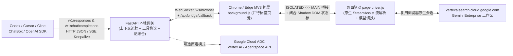

# Gemini Enterprise Responses Bridge

将浏览器中已登录的 **Google Cloud Gemini Enterprise（Vertex AI Search / Agentspace，`vertexaisearch.cloud.google.com`）** 封装为本地标准 **OpenAI Responses API（`/v1/responses`）与 Chat Completions API（`/v1/chat/completions`）** 双协议网关。

本项目专为 **Codex Desktop / CLI** 等重度长程编码智能体深度打磨，同时无缝兼容 **Cursor、Cline、Roo Code、ChatBox、NextChat、Cherry Studio、Open WebUI** 以及官方 OpenAI Python / TypeScript SDK。

> **免责声明 (Disclaimer)**：本项目为非官方本地开发辅助与协议适配工具，与 Google LLC / Google Cloud 无任何隶属、合作或官方背书关系。请严格遵守所在机构/企业的 IT 安全规范与 Google 服务条款。若具备 GCP 项目 IAM 权限，亦可直接切换至内置的 `gcloud` 官方 ADC 模式。
>
> **安全说明 (Security)**：默认仅监听本机回环地址 `127.0.0.1:8000`（请勿暴露至 `0.0.0.0` 或公网），可通过 `BRIDGE_API_KEY` 启用本地 Bearer 鉴权。全链路复用用户已登录的真实浏览器标签页，**绝不提取、落盘或转发任何 Google 账号 Cookie、Session 或访问令牌**。

---

## 核心特性

### 1. 原生 OpenAI Responses 协议与 Chat Completions 双栈支持
- **完整 Responses 协议 (`responses_api.py`)**：原生支持 `POST /v1/responses`（SSE 流式事件与非流式 JSON）、`GET / DELETE /v1/responses/{response_id}`、`previous_response_id` 跨轮状态续接、`POST /v1/responses/input_tokens` 输入预算估算以及 `POST /v1/responses/compact` 会话检查点浓缩。
- **完整 Chat Completions 与周边端点 (`server.py`)**：同时支持 `/v1/chat/completions`、`/v1/models`、`/v1/files`、`/v1/images/generations`、`/v1/images/edits`、`/v1/videos/generations`、`/v1/audio/transcriptions` 与 `/v1/audio/translations`（所有 `/v1/*` 路由均兼容省略 `/v1` 前缀）。

### 2. 原始网络流单一真源与根源级防断流驱动 (`page-driver.js` v2.8.2)
- **单一权威数据面**：Shadow DOM 仅用于操控输入框、切换模型菜单与挂载多模态附件；模型正文增量与最终回复唯一取自页面原生 `streamAssist` 网络响应流，杜绝网页 Markdown 渲染改写造成的文本污染。
- **主响应流隔离锁 (`primaryStreamToken`)**：自动过滤 `/batchexecute`、会话创建/查询与前端埋点等后台 RPC，防止并发杂项请求抢占状态或提前截断长回复；支持 XSSI 前缀剥离与流结束 UTF-8 尾字节完整冲刷。
- **网页装饰无损剥离 (`web_text.py`)**：流式与非流式双向清除网页自动附加的 `[[section:...]]` 标题锚点与 `suggested_questions` 推荐追问块，同时完整保留文档示例围栏内的字面内容。

### 3. 面向长程编码智能体的工具调用协议 (`tool_calling.py`)
- **专用三反引号协议块**：统一采用 `codex_tool_call`、`codex_tool_result` 与 `codex_history` 结构化 JSON 围栏，严格执行 RFC 8259 JSON 语法校验并阻断网页 Markdown 反斜杠转义污染；原生兼容 Codex `freeform` `apply_patch` 与带命名空间的工具声明（如 `functions.*`、`mcp__*`）。
- **并行只读放行与副作用串行保护**：安全识别并放行并行只读工具与只读 Shell 管道（`rg`、`grep`、`sed -n`、`nl`、`cat`、`head`、`tail`、`find`、`git status/diff/log/show` 等），同时对文件修改和状态变更命令强制单步等待真实结果后再继续。
- **超大载荷无损分片**：下行 `>32KB` 超长上下文自动经 `ReassemblyBuffer` 分块重组并一次性写入编辑器；上行超大补丁或长回复通过 `/api/bridge/callback` 直传网关，SSE 流按 `<=12KB` 安全切片推送，彻底规避 WebSocket 帧与行缓冲限制。

### 4. 百万上下文管理、增量续聊与 Codex 配置同步
- **智能增量上下文 (`context_builder.py`)**：同一会话多轮对话与工具循环默认启用 `smart_incremental_delta`，仅向原网页对话发送最新增量内容；新建会话或切换分支历史时自动开启干净网页对话并打包上下文。
- **Carbon 上下文水位与自动浓缩 (`agent_policy.py`)**：针对 `gemini-4-carbon` / `gemini-4-argon` 登记 `1,048,576` token 容量与 `300,000` token 本地稳定性浓缩阈值，配套 `configure_codex_context.py` 与 `codex-models.json` 一键预览或同步本地 Codex 配置（自动备份且不影响其他模型提供商）。

### 5. 多标签页真并行池、手动免接管保护与无感热升级
- **默认全池并行 + 按需后台扩容**：打开的 Gemini Enterprise 标签页在数量上限内自动注册为独立并发槽位（`WorkerSlot`），多窗口智能体可同时流式运行且互不阻塞；池满时支持后台静默新建工作页（`BRIDGE_AUTO_SPAWN_TABS=true`）。
- **一键“手动自用 · 免接管”与页内悬浮胶囊**：插件弹窗及每个 Gemini 网页右下角的闭合 Shadow DOM 状态胶囊均支持实时查看席位状态（已接管 / 工作中 / 手动自用 / 超出上限），一键将当前页面及会话锁定为个人自用（重启浏览器亦不会被抢占）。
- **驱动热升级与远程重载**：后台自动比对页面 `driverVersion` 并无感热替换新版驱动脚本，支持通过 `POST /api/extension/reload` 在空闲时远程重载扩展。

### 6. 全栈多模态输入输出、MCP 生图服务与成本记账台
- **多模态附件与产物持久化 (`media_inputs.py` / `media_outputs.py`)**：支持常见图片（PNG/JPEG/WebP/GIF/HEIC/SVG/AVIF 等）、PDF/文档与音视频输入上传，自动捕获并落盘网页生成的原图、视频与导出文件；内置零第三方依赖的 stdio MCP 工具 `imagegen_mcp.py`（`generate_image`）。
- **可视化控制台与等价成本记账 (`dashboard_html.py` / `usage_ledger.py`)**：访问 `http://127.0.0.1:8000/` 即可查看实时工作池水位、单席位重置、一键模型连通性测试，以及按日/模型/任务类型统计上下文缓存节省额与 USD/CNY 官方 API 等价费用的本地记账台。

### 7. 公网安全分发、多租户隔离与全栈跨平台兼容 (`distribution.py` / `tunnel_manager.py` / `platform_compat.py`)
- **多客户端专属密钥与租户隔离**：支持签发 `sk-geb-...` 外部客户端密钥，隔离会话历史、文件空间与用量账本，支持主机保底席位预留、并发/频率/日预算配额管控、到期时间及模型/网段白名单。
- **内置免费公网隧道与跨平台运行**：控制台内置 Cloudflare 免费加密隧道一键启停与外部连通自检（公网/反代流量自动拦截免密访问并锁定管理面仅本机可用）；完整兼容 macOS、Linux 与 Windows 10/11（含 `start.ps1`、`start.bat`、`stop.bat` 后台静默守护及开机自启）。

---

## 系统架构



---

## 快速开始

### 1. 启动本地网关服务

**macOS / Linux：**

```bash
python3 -m venv .venv
./.venv/bin/pip install -r requirements.txt
cp -n env.example .env
./.venv/bin/python server.py
```

**Windows（PowerShell 一键初始化并启动）：**

```powershell
# 前台启动（首次自动创建独立环境并安装依赖）：双击 start.bat 或运行
.\start.ps1

# 后台静默启动 / 安全停止 / 查看状态（自动检查在途请求，避免中断活跃任务）
.\start.ps1 -Background
.\start.ps1 -Stop
.\start.ps1 -Status

# 设置或移除 Windows 登录自动后台启动
.\start.ps1 -InstallStartup -Background
.\start.ps1 -UninstallStartup
```

服务启动时会自动在项目下导出完整的 `extension/`（含 `16/48/128` 图标）与 `userscript/` 目录，并监听 `http://127.0.0.1:8000`。

### 2. 加载 Chrome / Edge 浏览器扩展

1. 打开 `chrome://extensions/`（或 `edge://extensions/`），开启右上角 **开发者模式**。
2. 点击 **加载已解压的扩展程序**，选择项目根目录下的 `extension` 文件夹。
3. 在浏览器中打开并登录 `https://vertexaisearch.cloud.google.com/` 任意工作区页面。
4. 页面右下角出现绿色 **Bridge 已接管** 状态胶囊（扩展图标显示 `ON`）即表示连接就绪；如需留出个人手动聊天页，点击胶囊或插件弹窗中的 **设为自用** 即可免除接管。

> **备选油猴方案**：若不便加载扩展，可在 Tampermonkey 中安装 `userscript/gemini-enterprise-bridge.user.js`（当检测到 MV3 扩展在线时，油猴脚本会自动让出控制权避免冲突）。

### 3. 接入客户端

#### 接入 Codex（Responses 协议）

在 `~/.codex/config.toml` 中将自定义 Provider 的 `base_url` 指向 `http://127.0.0.1:8000/v1`、`wire_api = "responses"`，并可运行内置同步工具写入 `gemini-4-carbon` / `gemini-4-argon` 的百万上下文与浓缩参数：

```bash
# 先预览变更（不修改现有文件）
./.venv/bin/python configure_codex_context.py

# 确认无误后备份并写入配置
./.venv/bin/python configure_codex_context.py --apply --backup-dir ./codex-config-backup

# Windows 一键生成/同步当前系统的 ~/.codex/gemini-bridge.config.toml 专用配置
.\start.ps1 -EnsureCodexProfile
```

#### 接入通用 OpenAI 兼容客户端（Cursor / Cline / ChatBox / SDK）

| 配置项 | 填写值 |
|---|---|
| **Base URL** | `http://127.0.0.1:8000/v1`（亦兼容 `http://127.0.0.1:8000`） |
| **API Key** | `.env` 中 `BRIDGE_API_KEY` 留空时可填任意值或留空；若已设置则填对应密钥 |
| **可用模型列表（默认首选 Carbon）** | `gemini-4-carbon`（默认主力）、`gemini-4-argon`、`gemini-3.1-pro`、`gemini-3.8-flash` |
| **强制新建网页对话后缀** | 在任意模型名后追加 `-newchat`（如 `gemini-4-carbon-newchat`） |
| **固定绑定独立会话槽位** | 在模型名后追加 `@会话标识`（如 `gemini-4-carbon@task1`）或传请求头 `X-Session-Id` |
| **自定义网页菜单模型透传** | `gemini-web:<网页菜单显示名称>` |
| **官方 GCloud ADC 模式** | `gemini-enterprise-gcloud` |

**Python OpenAI SDK（Responses API）调用示例：**

```python
from openai import OpenAI

client = OpenAI(base_url="http://127.0.0.1:8000/v1", api_key="sk-local-bridge")

response = client.responses.create(
    model="gemini-4-carbon",
    input="请简要梳理当前项目的模块职责",
    stream=True,
)
for event in response:
    if event.type == "response.output_text.delta":
        print(event.delta, end="", flush=True)
```

---

## 主要接口一览

| 路径 | 说明 |
|---|---|
| `GET /` | 本地可视化管理控制台、工作席位监控、连通测试与成本记账面板 |
| `GET /health`、`GET /api/status` | 服务健康检查、连接池状态、最近上下文诊断与实时日志 |
| `GET /api/usage` | 按今日 / 本会话 / 累计 / 模型 / 任务分类查询本地 Token 与等价费用账本 |
| `POST /api/slots/reset` | 重置指定空闲工作席位为全新网页对话 |
| `POST /api/extension/reload` | 在空闲状态下通知已连接的浏览器扩展执行热重载 |
| `GET / POST /api/distribution/*`、`/*/tunnel/*` | 仅本机直连可用的多客户端密钥签发、配额管理、会话总控与公网隧道启停接口 |
| `POST /v1/responses` | OpenAI Responses 协议主入口（支持流式 SSE、工具循环、多模态与 `previous_response_id`） |
| `POST /v1/responses/input_tokens` | Responses 输入 Token 预算估算 |
| `POST /v1/responses/compact` | Responses 长对话上下文检查点浓缩 |
| `POST /v1/chat/completions` | OpenAI Chat Completions 协议入口（支持流式 SSE、`tools` 与 `response_format`） |
| `GET /v1/models` | 返回可用模型列表 |
| `POST / GET / DELETE /v1/files*` | 多模态输入与网页生成产物的本地文件存取接口 |
| `POST /v1/images/generations`、`/edits` | 通过 Gemini Enterprise 执行文生图与参考图编辑并落盘返回 |
| `POST /v1/videos/generations` | 通过 Gemini Enterprise 执行视频生成并持久化保存 |

---

## 常用环境变量（`.env`）

| 变量名 | 默认值 | 说明 |
|---|---|---|
| `BRIDGE_HOST` | `127.0.0.1` | 监听地址（强烈建议保持 `127.0.0.1`） |
| `BRIDGE_PORT` | `8000` | 本地服务监听端口 |
| `BRIDGE_API_KEY` | 空 | 留空时不强制校验密钥；设置非空值后所有接口均需 Bearer 鉴权 |
| `BRIDGE_DEFAULT_MODEL` | `gemini-4-carbon` | 客户端未指定模型或请求默认模型时选用的目标模型 |
| `BRIDGE_BACKEND_MODE` | `browser` | 上游模式：`browser`（浏览器桥接）、`gcloud`（官方 ADC）、`auto` |
| `BRIDGE_CONTEXT_MODE` | `smart` | 多轮上下文策略：`smart`（智能增量）、`last_message`、`transcript` |
| `BRIDGE_AUTO_RESET_NEW_CHAT` | `true` | 本地开启新对话或切换分支时自动在网页端开启干净新对话 |
| `BRIDGE_MAX_PARALLEL_TABS` | `4` | 最大并行接管浏览器标签页数量 |
| `BRIDGE_AUTO_SPAWN_TABS` | `true` | 活跃槽位全忙时是否在后台静默新建 Gemini 工作标签页 |
| `BRIDGE_REQUEST_TIMEOUT` | `600` | 单轮生成超时时间（秒，流式持续输出期间动态续期） |
| `BRIDGE_INCLUDE_CITATIONS` | `true` | 是否在普通问答末尾附上企业检索引用来源 |

---

## 项目目录结构

```text
.
├── server.py                         # FastAPI 网关主入口与多协议路由挂载
├── responses_api.py                  # OpenAI Responses 协议栈、状态存储与浓缩端点
├── schemas.py                        # 请求/响应数据模型、Token 估算与网页模型别名解析
├── tool_calling.py                   # codex_tool_call 专用围栏协议、并行只读校验与流式缓冲器
├── web_text.py                       # 网页 [[section:...]] 与 suggested_questions 流式/静态过滤器
├── context_builder.py                # 智能多轮增量上下文构建与会话历史前缀匹配
├── agent_policy.py                   # Carbon 百万上下文预算、浓缩提示词与编码工作流策略
├── bridge_hub.py                     # WebSocket / HTTP 桥接调度中心、并行槽位池与完整性校验
├── media_inputs.py / media_outputs.py# 多模态附件校验、FileStore 存储与网页生成产物持久化
├── image_inputs.py / image_outputs.py# 图像输入预处理与生成图片提取辅助
├── imagegen_mcp.py                   # 面向 Codex 的零依赖 stdio MCP 图像生成/编辑工具
├── distribution.py                   # 多客户端密钥鉴权、租户隔离、席位配额与调用流水管控
├── tunnel_manager.py                 # Cloudflare 公网加密隧道生命周期管理与安全自检
├── platform_compat.py                # macOS / Linux / Windows 跨平台编码、路径与进程兼容层
├── usage_ledger.py                   # 本地 Token、缓存节省额与官方 API 等价费用记账模块
├── dashboard_html.py                 # http://127.0.0.1:8000/ 可视化控制台与记账前端
├── configure_codex_context.py        # 本地 Codex 模型目录（codex-models.json）与配置同步脚本
├── gcloud_provider.py                # 可选 Google Cloud CLI ADC 官方接口上游
├── extension_exporter.py             # 纯标准库图标生成与独立 extension/、userscript/ 打包器
├── background.js                     # MV3 扩展后台（标签页池接管调度、免接管锁定、热注入与重连）
├── content-bridge.js                 # ISOLATED 世界安全中继与网页右下角闭合 Shadow DOM 状态胶囊
├── page-driver.js                    # MAIN 世界驱动（原生流解析、主响应流锁、深层 Shadow DOM 操控）
├── popup.html / popup.css / popup.js # 扩展可视化状态弹窗与当前标签页免接管快捷控制
├── start.ps1 / start.bat / stop.bat  # Windows 10/11 一键初始化、后台静默启停与开机自启脚本
├── extension/                        # 自动导出的 Chrome / Edge 未打包扩展目录
├── userscript/                       # 自动导出的 Tampermonkey 备选脚本目录
└── test_*.py / test_*.mjs            # Python (Pytest) 与 Node.js 全链路回归测试套件
```

---

## 自动化测试

项目内置完整的 Python 端到端协议测试与 Node.js 浏览器驱动/后台恢复测试，无需真实外部网络即可在本地离线验证：

```bash
# 运行全部 Python 单元测试与协议集成测试
./.venv/bin/pytest -q

# 运行全部浏览器驱动、网络流完整性与扩展后台回归测试
for f in test_*.mjs; do node "$f"; done
```
