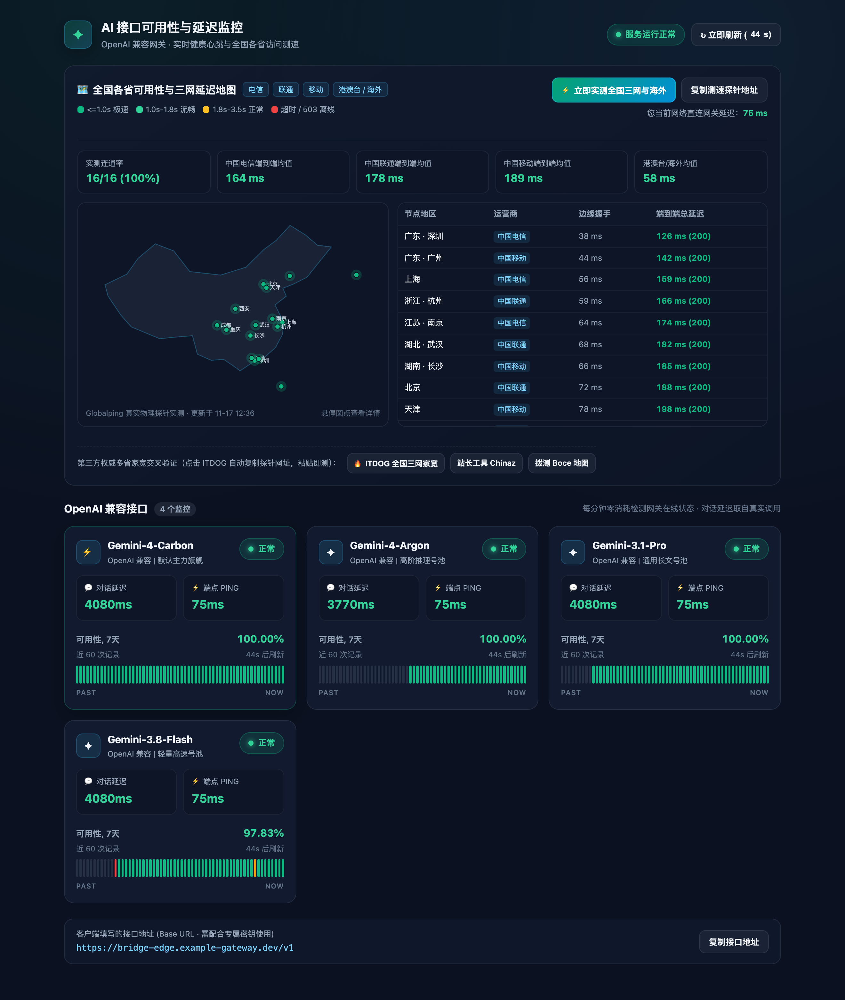
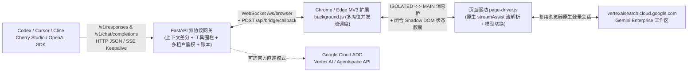

<div align="center">


<br />

[](#quickstart)
[](#requirements)
[](#extension-setup)
[](#api-routes)
[-D97706?style=for-the-badge&logo=googlegemini&logoColor=white)](#model-routing)
[](LICENSE)

<p align="center">
  <b>简体中文</b> · <a href="README_EN.md">English</a>
</p>

<p align="center">
  <a href="#overview">✨ 产品导览</a> ·
  <a href="#gallery">🖼️ 界面实拍</a> ·
  <a href="#quickstart">🚀 3 分钟上手</a> ·
  <a href="#client-setup">🔌 软件接入</a> ·
  <a href="#faq">💡 常见问题</a> ·
  <a href="#tech-reference">🛠️ 工程技术手册</a>
</p>

</div>

---

<a id="overview"></a>

## ✨ 一句话看懂它在做什么

如果你拥有学校、研究机构或公司提供的 **Google Gemini Enterprise 网页版权限**（`vertexaisearch.cloud.google.com`），你一定体验过它的强大：顶尖的 **Carbon / Argon** 模型、高达 **100 万字的上下文记忆**、联网检索，还能直接画图、改图、生成视频。

但网页版有一个最大的遗憾——**它被困在浏览器标签页里**。写代码时要来回复制粘贴，读长文档要手动上传，更没法直接放进你顺手的 AI 编程软件或桌面客户端里。

**Gemini Enterprise Bridge 就是为你架起的一座「本机隐形桥梁」：**

> 你只需要像平时一样在浏览器里登录好网页，它就能在你的电脑本地自动变出一个**通用的标准 AI 接口**——不需要抓包、不需要提取账号 Cookie、不需要买昂贵的按量计费 API。你电脑上的 **Codex、Cursor、Cline、Cherry Studio、ChatBox** 乃至你的手机，都能立刻直接调用它来写代码、改文件、分析财报 PDF、生成图片和视频。

<p align="center">
  
</p>

---

## 🌟 为什么大家喜欢用它？

<table>
  <tr>
    <td width="33%" valign="top">
      <h3>🔌 主流 AI 软件全打通</h3>
      <p>原生支持最新 <b>OpenAI Responses</b> 与 <b>Chat Completions</b> 双标准接口。无论是重度自动写代码的 <b>Codex / Cursor / Cline</b>，还是日常聊天的 <b>Cherry Studio / ChatBox / NextChat</b>，填上地址就能直接用。</p>
    </td>
    <td width="33%" valign="top">
      <h3>🧭 全中文图形化总控台</h3>
      <p>告别枯燥难懂的黑框命令行。浏览器打开本机总台，就能直观查看每个工作页的健康度、做<b>一键连通体检</b>、在线试聊，还自带傻瓜式的「第三方软件接入指南」。</p>
    </td>
    <td width="33%" valign="top">
      <h3>⚡ 多开网页真并发 · 自用防打扰</h3>
      <p>打开多个 Gemini 网页就能<b>同时并行处理多路任务</b>，繁忙时还能在后台自动加开工作页。网页右下角自带悬浮小胶囊，点一下<b>「设为自用」</b>就能永久保护你自己的聊天页不被 AI 抢占。</p>
    </td>
  </tr>
  <tr>
    <td width="33%" valign="top">
      <h3>🎨 文档、图片、音视频全能</h3>
      <p>直接拖入 PDF、Word、Excel、PPT、录音、视频，甚至苹果手机拍的 <b>HEIC 照片 / MOV 视频</b>都会自动转码识别；模型画出的高清原图与生成的视频也会自动保存到本机。</p>
    </td>
    <td width="33%" valign="top">
      <h3>🌐 一键免费公网 & 好友共享</h3>
      <p>免买服务器、免买域名，内置 Cloudflare 免费加密公网通道。支持生成多把独立的 <code>sk-geb-...</code> 专属子密钥，单独限制并发、每日额度与到期日，电脑合盖休眠唤醒后还会自动重连修复。</p>
    </td>
    <td width="33%" valign="top">
      <h3>📊 省钱账本 & 全国延迟大屏</h3>
      <p>内置精美的等价费用记账台，按人民币/美元实时算出<b>「多轮续聊帮你省下了多少官方 API 费用」</b>；同时提供可公开分享的 <code>/status</code> 监控页，支持 7 天可用率与全国三网延迟地图实测。</p>
    </td>
  </tr>
</table>

---

<a id="gallery"></a>

## 🖼️ 真实界面全景实拍

> 以下全部为项目真实运行界面的高清实拍（演示数据已脱敏），装好后你在电脑上看到的就是一模一样的界面。

### 1. 本机可视化管理总台 · 工作席位与记忆监控

一眼看清本机服务、浏览器插件与 Google 登录三步就绪状态；实时展示每个并行浏览器工作页正在执行的任务、轮次以及百万级上下文记忆余量。

<p align="center">
  
</p>

### 2. 贴心细节：插件快捷弹窗 · 免接管胶囊 · 公网共享与省钱账本

<table>
  <tr>
    <td width="50%" valign="top">
      
      <p align="center"><b>🧩 浏览器插件弹窗 & 网页右下角「免接管」状态胶囊</b><br/><sub>在网页上轻轻一点，即可把个人聊天页锁定为「手动自用」，与后台接口任务彻底隔离。</sub></p>
    </td>
    <td width="50%" valign="top">
      
      <p align="center"><b>🌐 一键免费公网通道 & 多客户端专属密钥管控</b><br/><sub>为手机、平板或团队伙伴签发独立密钥，支持本机保底席位预留、每日额度上限与一键踢下线。</sub></p>
    </td>
  </tr>
  <tr>
    <td width="50%" valign="top">
      
      <p align="center"><b>📡 可公开分享的实时可用率 & 全国三网延迟地图（<code>/status</code>）</b><br/><sub>外部无需密钥即可查看主力模型 7 天在线率，并调度电信/联通/移动与海外真实节点拨测延迟。</sub></p>
    </td>
    <td width="50%" valign="top">
      
      <p align="center"><b>💰 等价费用省钱账本 & 缓存命中率统计</b><br/><sub>支持人民币 / 美元一键切换，按天、按模型、按任务类型与各子密钥清晰统计 Token 与折算价值。</sub></p>
    </td>
  </tr>
</table>

<details>
  <summary><b>📂 点击展开更多实拍：实时在途任务追踪与历史会话审计中心</b></summary>
  <br />
  <p align="center">
    
  </p>
  <p align="center"><sub>实时查看当前哪把密钥、在哪个浏览器席位上流式生成，并支持按调用方检索、管理或清理历史会话。</sub></p>
</details>

---

<a id="quickstart"></a>

## 🚀 3 分钟极速上手

<a id="requirements"></a>

### 📋 运行环境与准备清单

| 准备项 | 要求说明 | 默认配置（开箱即用） |
|---|---|---|
| **💻 操作系统** | **macOS**、**Windows 10 / 11**、**Linux** 全平台原生支持 | 自动适配系统编码与路径 |
| **🐍 运行环境** | **Python 3.10** 及以上版本 | Windows 脚本首次运行自动配好虚拟环境 |
| **🌐 浏览器** | **Google Chrome** 或 **Microsoft Edge**（亦附带油猴脚本备选） | 启动服务时自动导出 `extension/` 插件目录 |
| **🔑 账号条件** | 浏览器可正常打开并登录 `vertexaisearch.cloud.google.com` | 复用浏览器登录态，**无需 GCP API 密钥** |
| **⚡ 默认参数** | 本机接口 `http://127.0.0.1:8000/v1` · 管理总台 `http://127.0.0.1:8000/` | 默认主力模型 `gemini-4-carbon`，本机免密直连 |

---

### 第一步：启动本机桥接服务

先将项目下载到电脑本地，进入项目文件夹后按你的系统运行：

#### 🍎 macOS / 🐧 Linux 用户

打开「终端（Terminal）」，复制粘贴以下四行命令即可完成首次安装并启动：

```bash
python3 -m venv .venv
./.venv/bin/pip install -r requirements.txt
cp -n env.example .env
./.venv/bin/python server.py
```

#### 🪟 Windows 10 / 11 用户

直接双击文件夹里的 **`start.bat`** 即可自动创建独立环境、安装依赖并启动服务！如果你喜欢后台静默运行或开机自启，也可以在 PowerShell 中使用内置管家脚本：

```powershell
# 后台静默启动（无黑框打扰）
.\start.ps1 -Background

# 安全查看状态 / 安全停止（自动检查在途任务，绝不强断正在生成的回复）
.\start.ps1 -Status
.\start.ps1 -Stop

# 可选：设置登录 Windows 时自动后台启动
.\start.ps1 -InstallStartup -Background
```

> [!TIP]
> 服务启动成功后，会自动在项目目录下生成带高清图标的 **`extension`** 浏览器扩展文件夹，并在本机打开 `http://127.0.0.1:8000` 服务。

---

<a id="extension-setup"></a>

### 第二步：把浏览器插件装好（只需点三下）

1. 在 Chrome 地址栏输入 `chrome://extensions/`（Edge 输入 `edge://extensions/`），打开右上角的 **「开发者模式」** 开关。
2. 点击左上角 **「加载已解压的扩展程序」**，选中项目文件夹里的 **`extension`** 目录。
3. 打开并登录你的 **[Gemini Enterprise 网页工作区](https://vertexaisearch.cloud.google.com/)**。
4. 看到网页右下角浮现绿色的 **`● Bridge 已接管 · #1`** 小胶囊（浏览器右上角插件图标亮起 `ON`），就代表已经成功连上啦！

> [!NOTE]
> **不想装扩展？** 项目同时自动生成了 `userscript/gemini-enterprise-bridge.user.js`，装入 Tampermonkey（篡改猴）同样可用；当检测到正式扩展在线时，油猴脚本会自动礼貌让出控制权，绝不冲突。

---

<a id="client-setup"></a>

### 第三步：连上你常用的 AI 软件

现在打开浏览器访问 **[http://127.0.0.1:8000/](http://127.0.0.1:8000/)** 就能看到你的全中文管理总台。在任何支持自定义 OpenAI 接口的软件里，按下面的卡片填入即可开始使用：

<table>
  <tr>
    <td width="50%" valign="top">
      <h4>💬 日常对话与全能客户端</h4>
      <p><sub>适用于 <b>Cherry Studio、ChatBox、NextChat、Open WebUI</b> 等</sub></p>
      <ul>
        <li><b>接口类型</b>：OpenAI 兼容（OpenAI Compatible）</li>
        <li><b>API 地址 (Base URL)</b>：<code>http://127.0.0.1:8000/v1</code></li>
        <li><b>API 密钥 (API Key)</b>：随便填（如 <code>sk-local</code>）或直接留空</li>
        <li><b>推荐模型名称</b>：<code>gemini-4-carbon</code>（主力全能）或 <code>gemini-4-argon</code>（深度推理）</li>
      </ul>
    </td>
    <td width="50%" valign="top">
      <h4>🧑‍💻 AI 编程助手与智能体</h4>
      <p><sub>适用于 <b>Codex Desktop / CLI、Cursor、Cline、Roo Code</b> 等</sub></p>
      <ul>
        <li><b>Base URL</b>：<code>http://127.0.0.1:8000/v1</code></li>
        <li><b>Codex 协议模式</b>：<code>wire_api = "responses"</code></li>
        <li><b>一键同步百万上下文配置（Codex 专属）</b>：<br/>运行 <code>./.venv/bin/python configure_codex_context.py --apply</code>（Windows 可运行 <code>.\start.ps1 -EnsureCodexProfile</code>），自动备份并写入 1M 上下文参数。</li>
        <li><b>GPT + Gemini 同菜单自动分流（Codex 进阶）</b>：<br/>运行 <code>./.venv/bin/python codex_model_router/install_router.py --apply</code>，即可保留原供应商全部模型并在同一列表中随选随切 Gemini，自动隔离原密钥。详见 <a href="docs/CODEX_MODEL_ROUTER.md">《Codex 模型分流系统与协作指示指南》</a>。</li>
      </ul>
    </td>
  </tr>
</table>

---

<a id="faq"></a>

## 💡 日常使用问答 (FAQ)

<details open>
  <summary><b>Q1：我自己平时也要在浏览器里用 Gemini 查资料聊天，后台跑接口会把我的聊天页面冲掉吗？</b></summary>
  <p><b>完全不会！</b>只要在你自己正在聊天的 Gemini 页面右下角，点击悬浮胶囊上的<b>「设为自用」</b>（或者在插件弹窗里点「设为我自己用」），这个页面就会变成琥珀色的<b>「手动自用 · 免接管」</b>保护状态。哪怕重启浏览器，Bridge 也绝不会碰它一下。</p>
</details>

<details>
  <summary><b>Q2：我想同时在 Codex 里跑两个编程任务，还要在 ChatBox 里问问题，会互相排队卡住吗？</b></summary>
  <p><b>不会排队！</b>你在浏览器里开几个 Gemini 标签页，Bridge 就会自动把它们组成一个<b>多席位真并发工作池</b>（默认支持多开并可在繁忙时自动后台新建工作页），多个任务在各自独立的标签页里同时流式输出，互不干扰。</p>
</details>

<details>
  <summary><b>Q3：怎么在手机上用，或者安全地分享给朋友/室友一起用？</b></summary>
  <p>打开本机总台左侧的<b>「🌐 公网通道与密钥」</b>，点一下<b>「一键开启免费公网」</b>（电脑需安装 <code>cloudflared</code>，macOS 可用 <code>brew install cloudflare/cloudflare/cloudflared</code> 安装），几秒钟就会生成加密 HTTPS 公网地址。接着在下方面板点「新建客户端密钥」，给手机或朋友生成一把 <code>sk-geb-...</code> 专属密钥，还能设置每日限额和本机保底席位。外部只能用密钥调接口，你的本机管理后台对外完全隐藏（返回 403）。</p>
</details>

<details>
  <summary><b>Q4：笔记本电脑合盖休眠、第二天醒来后公网地址断了怎么办？</b></summary>
  <p>项目内置了<b>休眠唤醒安全自检与自动恢复机制</b>：当检测到临时公网域名过期或通道失联时，系统会先确认当前没有正在生成或排队的任务，随后安全重建新通道并自动同步到客户端接入指引中。Windows 详细维护可参阅 <a href="WINDOWS_TUNNEL_RECOVERY.md">《休眠后公网连接修复说明》</a>。</p>
</details>

<details>
  <summary><b>Q5：这种原理安全吗？会不会导致我的学校/机构 Google 账号被封或密码泄露？</b></summary>
  <p>本工具采用<b>「真实浏览器在环（Browser-in-the-Loop）」</b>设计：所有对话都在你亲手登录的真实 Chrome/Edge 页面内自然完成，<b>绝不提取、落盘、解密或转发任何 Google Cookie、Session 或 OAuth Token</b>；服务端默认仅绑定本机回环地址 <code>127.0.0.1</code>，最大程度保护你的账号与企业数据安全。</p>
</details>

<br />

---

<div align="center">

<a id="tech-reference"></a>

# 🛠️ 架构设计与工程技术手册

<sub><b>Technical Architecture, Protocol Specification & Engineering Reference</b> · 以下内容面向开发者、系统架构师与高阶定制用户</sub>

</div>

---

## 6.1 系统拓扑与全链路数据面架构

**Gemini Enterprise Responses Bridge** 是一个将浏览器内已认证的 **Google Cloud Gemini Enterprise（Vertex AI Search / Agentspace，`vertexaisearch.cloud.google.com`）** 封装为本地标准 **OpenAI Responses API（`/v1/responses`）** 与 **Chat Completions API（`/v1/chat/completions`）** 的双栈网关系统，专为 **Codex Desktop / CLI** 等长程多步工具调用智能体深度优化。



---

## 6.2 核心工程机制深度解析

### 1. 原始网络流单一真源与根源级防断流驱动（`page-driver.js` + `web_text.py`）

- **控制面与数据面严格解耦**：页面深层 Shadow DOM 仅承担控制面职责（定位输入框、切换网页模型菜单、挂载多模态附件）；模型的流式增量文本与最终完整输出**唯一取自浏览器原生 `streamAssist` 网络响应流**，从根源上杜绝网页端 Markdown 渲染器改写代码块、吞噬缩进或转义特殊符号造成的文本污染。
- **主响应流隔离锁（`primaryStreamToken`）**：自动识别并过滤 `/batchexecute`、会话元数据创建/查询与前端遥测等并发后台 RPC，防止杂项请求抢占活跃流锁或提前截断长篇代码输出；内置 Google XSSI 前缀剥离与流结束时的 UTF-8 多字节尾块完整冲刷。
- **网页装饰无损剥离（`web_text.py`）**：流式状态机与静态后处理器双向剥离网页端自动注入的 `[[section:...]]` 章节锚点及 `suggested_questions` 推荐追问围栏块，同时完整保留用户代码与文档示例围栏内的字面内容。

### 2. 面向长程编码智能体的工具调用协议（`tool_calling.py`）

- **结构化三反引号协议块**：统一使用 `codex_tool_call`、`codex_tool_result` 与 `codex_history` 专用围栏承载工具交互，强制执行 **RFC 8259 JSON** 严格语法解析，主动防御网页端对 `*`、`_`、`|`、`#`、`[`、`]` 的 Markdown 反斜杠转义污染；原生适配 Codex `freeform` `apply_patch` 补丁语法及带命名空间的工具声明（如 `functions.*`、`mcp__*`）。
- **并行只读放行与副作用串行屏障**：静态语法分析器自动识别并放行安全的并行只读工具调用与只读 Shell 管道（`rg`、`grep`、`sed -n`、`nl`、`cat`、`head`、`tail`、`find`、`git status/diff/log/show` 等），而对文件写入、构建脚本与状态变更命令强制单步串行等待客户端真实执行结果。
- **超大载荷无损分片传输**：下行 `>32KB` 超长上下文经 `ReassemblyBuffer` 分块校验重组后一次性注入编辑器；上行超大补丁或长回复通过本地 HTTP `/api/bridge/callback` 旁路直传网关，SSE 事件流按 `<=12KB` 安全切片推送并辅以心跳保活，彻底规避 WebSocket 帧上限与客户端行缓冲溢出。

### 3. 百万级上下文增量引擎与稳定性浓缩（`context_builder.py` + `agent_policy.py`）

- **智能增量差分（`smart_incremental_delta`）**：基于会话历史前缀指纹匹配，同一对话的多轮追问与连续工具循环仅向网页既有会话增量投递最新差量（Delta），大幅降低首字延迟并提升等价缓存命中率；当检测到客户端开启新话题或回滚历史分支时，自动触发网页端干净新会话重置并完整打包上下文。
- **Carbon 百万窗口登记与检查点浓缩**：针对 `gemini-4-carbon` 与 `gemini-4-argon` 统一登记 `1,048,576` Token 总容量窗口与 `300,000` Token 本地高稳定浓缩水位，原生实现 `POST /v1/responses/compact` 与 `POST /v1/responses/input_tokens`，配套 `configure_codex_context.py` 安全同步本地 `~/.codex/config.toml` 与 `codex-models.json`。

### 4. 多标签页并发槽位池、会话亲和度与无感热升级（`bridge_hub.py` + `background.js`）

- **动态并发槽位池（`WorkerSlot`）**：每个已接管的 Gemini Enterprise 标签页注册为独立工作席位，具备会话亲和度粘性保留（`BRIDGE_SESSION_AFFINITY_TTL`）与 SQLite 会话归档重入能力；全池满载时支持后台静默扩容新标签页（`BRIDGE_AUTO_SPAWN_TABS=true`）。
- **闭合 Shadow DOM 免接管隔离**：网页右下角状态胶囊运行于 `mode: "closed"` 的独立 ShadowRoot 内，既对页面驱动遍历完全透明，又支持将指定标签页及会话持久化锁定为个人自用。
- **驱动热替换与空闲安全重载**：扩展后台自动比对页面注入的 `driverVersion` 并无感热升级新版驱动脚本；支持通过 `POST /api/extension/reload` 在确认零在途请求后安全热重载扩展。

### 5. 全模态编解码管线与零依赖 MCP 生图服务（`media_inputs.py` / `media_outputs.py` / `imagegen_mcp.py`）

- **多格式自动转码与 FileStore**：原生支持图片（PNG/JPEG/WebP/GIF/SVG/AVIF 及自动转 PNG 的 HEIC/TIFF/BMP）、文档（PDF/DOCX/XLSX/PPTX/CSV/MD/代码及自动转 DOCX 的 RTF）、音频（MP3/M4A 及自动转 M4A 的 WAV/AIFF/OGG/FLAC）与视频（MP4 及自动转 MP4 的 MOV）输入上传；自动捕获网页端生成的原始分辨率图片与视频落盘至本地 `FileStore`。
- **内置 stdio MCP 工具**：`imagegen_mcp.py` 仅依赖 Python 标准库即可作为 Codex / Claude Desktop 的本地 MCP Server 运行，暴露 `generate_image` 文生图与参考图改图能力。

### 6. 多租户分发、公网隧道自愈与全球拨测监控（`distribution.py` / `tunnel_manager.py` / `public_status.py`）

- **多租户隔离与主机保底预留**：签发 `sk-geb-...` 外部密钥，按租户严格隔离会话空间、文件存储与用量流水；支持主机保底席位预留（`host_reserved_slots`）、最大并发数、RPM 速率限制、每日请求数/Token/美元预算上限、有效期、模型白名单与来源 IP/CIDR 白名单。
- **管理面零信任封锁与休眠自愈**：通过 `CF-Connecting-IP` / `X-Forwarded-*` 边缘头识别代理流量，外部流量一律强制校验有效客户端密钥，且管理控制台（`/`、`/api/status`、`/api/distribution/*`、`/api/tunnel/*`）强制仅限本机环回直连访问；内置 DoH 权威 NXDOMAIN 判定与休眠后空闲安全重建逻辑。
- **零隐私泄露公开探针（`/status`）**：提供免鉴权的 `/status` 可视化监控页与 `/status/ping` 探针（就绪返回 `200`，无可用席位返回 `503`），区分客户端 `401/429` 鉴权限流与真实上游故障，并集成 Globalping 全球/全国三网真实物理节点 HTTP 拨测。

---

<a id="model-routing"></a>

## 6.3 模型路由语法与高级修饰符

| 模型标识 / 路由写法 | 映射行为说明 |
|---|---|
| `gemini-4-carbon` | **默认主力模型**（综合编码、长程工具调用与多模态理解首选，1M 上下文） |
| `gemini-4-argon` | **深度思考模型**（复杂数学推导、架构设计与疑难逻辑分析，1M 上下文） |
| `gemini-3.1-pro` | 映射到工作区 Gemini 3.1 Pro 模型 |
| `gemini-3.8-flash` | 映射到工作区高速轻量 Flash 模型 |
| `<模型名>-newchat` | **强制新开对话后缀**（例如 `gemini-4-carbon-newchat`），忽略历史缓存并在网页端开启全新对话 |
| `<模型名>@<会话ID>` | **固定席位亲和路由**（例如 `gemini-4-carbon@task-auth`），与请求头 `X-Session-Id` 等效，将特定工作流绑定至专属席位 |
| `gemini-web:<菜单名称>` | **自定义菜单透传**，按网页模型下拉菜单中的显示文本动态匹配目标模型 |
| `gemini-enterprise-gcloud` | 绕过浏览器，改用官方 Google Cloud CLI ADC（Vertex AI / Agentspace API）直连 |

---

## 6.4 代码调用示例

### Python OpenAI SDK — Responses API（流式输出）

```python
from openai import OpenAI

client = OpenAI(
    base_url="http://127.0.0.1:8000/v1",
    api_key="sk-local-bridge",  # 本机未设置 BRIDGE_API_KEY 时填任意非空字符串即可
)

stream = client.responses.create(
    model="gemini-4-carbon",
    input="请审阅当前项目的鉴权中间件设计，并给出潜在边界风险清单。",
    stream=True,
)

for event in stream:
    if event.type == "response.output_text.delta":
        print(event.delta, end="", flush=True)
```

### Python OpenAI SDK — Chat Completions API（含工具调用）

```python
from openai import OpenAI

client = OpenAI(base_url="http://127.0.0.1:8000/v1", api_key="sk-local-bridge")

resp = client.chat.completions.create(
    model="gemini-4-carbon",
    messages=[{"role": "user", "content": "查询香港今天的天气概况"}],
    tools=[
        {
            "type": "function",
            "function": {
                "name": "get_weather",
                "description": "获取指定城市的实时天气",
                "parameters": {
                    "type": "object",
                    "properties": {"city": {"type": "string"}},
                    "required": ["city"],
                },
            },
        }
    ],
)
print(resp.choices[0].message)
```

---

<a id="api-routes"></a>

## 6.5 完整接口路由矩阵

> 所有 `/v1/*` 业务端点均同时兼容省略 `/v1` 前缀的别名路径（如 `/responses`、`/chat/completions`、`/models`、`/files`）。

### A. OpenAI 标准业务与多模态接口

| 方法与路径 | 功能说明 |
|---|---|
| `POST /v1/responses` | OpenAI Responses 协议主入口（支持 SSE 流式、多轮工具调用、多模态输入与 `previous_response_id` 续接） |
| `GET / DELETE /v1/responses/{id}` | 查询或删除已持久化的 Response 状态记录 |
| `POST /v1/responses/input_tokens` | Responses 请求输入 Token 预算精确估算 |
| `POST /v1/responses/compact` | 长程对话上下文检查点浓缩端点 |
| `POST /v1/chat/completions` | OpenAI Chat Completions 标准接口（支持流式 SSE、`tools` / `tool_choice` 与 `response_format`） |
| `GET /v1/models` | 获取当前网关支持的模型目录清单 |
| `POST / GET / DELETE /v1/files*` | 多模态输入附件上传、元数据查询、内容读取与清理 |
| `POST /v1/images/generations` | 调用 Gemini Enterprise 文生图并落盘返回本地 URL / Base64 |
| `POST /v1/images/edits` | 上传参考图执行局部/风格编辑并落盘返回结果图片 |
| `POST /v1/videos/generations` | 调用 Gemini Enterprise 生成视频并持久化保存 MP4 文件 |
| `POST /v1/audio/transcriptions` | 音频语音识别转写与跨语种翻译（含 `/v1/audio/translations`） |

### B. 本机管理总台、多租户分发与公开监控接口

| 方法与路径 | 访问权限 | 功能说明 |
|---|---|---|
| `GET /` | 仅限本机直连 | 本地可视化管理总台（工作席位、连通体检、公网与密钥、审计中心、费用账本） |
| `GET /api/status`、`GET /api/usage` | 仅限本机直连 | 网关全量运行态快照、席位上下文水位与多维成本账本查询 |
| `POST /api/slots/reset` | 仅限本机直连 | 将指定空闲浏览器席位重置为干净新网页会话（忙碌席位自动拒绝并返回 `409`） |
| `POST /api/extension/reload` | 仅限本机直连 | 在零在途任务前提下通知已连接浏览器扩展执行热重载 |
| `GET / POST /api/tunnel/*` | 仅限本机直连 | Cloudflare 公网隧道一键启动、安全停止与外部端到端连通自检 |
| `GET / POST / DELETE /api/distribution/*` | 仅限本机直连 | 全局共享策略配置、外部客户端密钥签发/轮换/限额重置/断连与吊销 |
| `GET / POST /api/sessions*` | 仅限本机直连 | 查看与按租户清理归档会话记录 |
| `GET /health` | 公开只读 | 基础进程存活健康检查 |
| `GET /status`、`GET /status/ping` | 公开只读（零隐私） | 公开可用性状态监控页、7 天在线率快照（`/api/public/status`）与全国多网拨测接口 |

---

## 6.6 环境变量配置参考（`.env`）

| 变量名 | 默认值 | 说明 |
|---|---|---|
| `BRIDGE_HOST` | `127.0.0.1` | 服务端绑定地址（强烈建议保持 `127.0.0.1`，公网共享请通过内置加密隧道受控暴露） |
| `BRIDGE_PORT` | `8000` | 本地监听端口 |
| `BRIDGE_API_KEY` | 空 | 本机主密钥；留空时本机直连免密，非空时所有请求均需携带对应 Bearer Key |
| `BRIDGE_DEFAULT_MODEL` | `gemini-4-carbon` | 客户端未指定模型或请求默认模型时选用的目标主力模型 |
| `BRIDGE_BACKEND_MODE` | `browser` | 上游运行模式：`browser`（浏览器桥接）、`gcloud`（官方 ADC 直连）、`auto`（自动回退） |
| `BRIDGE_CONTEXT_MODE` | `smart` | 多轮上下文投递策略：`smart`（智能增量差分）、`last_message`、`transcript` |
| `BRIDGE_AUTO_RESET_NEW_CHAT` | `true` | 客户端开启新对话或切换历史分支时，是否自动在网页端开启干净新会话 |
| `BRIDGE_MAX_PARALLEL_TABS` | `6` | 最大并行接管浏览器工作标签页上限 |
| `BRIDGE_AUTO_SPAWN_TABS` | `true` | 现有席位全部忙碌时，是否自动在后台静默新建 Gemini 工作页 |
| `BRIDGE_SESSION_AFFINITY_TTL` | `300` | 活跃会话在工作席位上的粘性保留时间（秒） |
| `BRIDGE_REQUEST_TIMEOUT` | `600` | 单轮生成超时时间（秒，流式持续输出期间自动续期） |
| `BRIDGE_QUEUE_TIMEOUT` | `300` | 并发满载时的请求排队最大等待时间（秒） |
| `BRIDGE_INCLUDE_CITATIONS` | `true` | 普通问答末尾是否附加企业知识库 / 网页检索引用来源 |
| `BRIDGE_USD_TO_CNY_RATE` | `6.8` | 本地省钱账本的美元兑人民币折算汇率 |

---

## 6.7 项目模块结构与自动化测试

```text
.
├── server.py                          # FastAPI 网关主入口、中间件鉴权与双协议路由编排
├── responses_api.py                   # OpenAI Responses 协议栈、持久化存储与浓缩端点
├── schemas.py                         # 数据模型、Token 估算标尺与模型路由别名解析
├── tool_calling.py                    # codex_tool_call 结构化围栏协议、并行只读分析与分片缓冲
├── web_text.py                        # 网页 [[section:...]] 与推荐追问流式/静态无损剥离器
├── context_builder.py                 # 智能多轮增量上下文构建、前缀指纹匹配与 SQLite 会话归档
├── agent_policy.py                    # Carbon/Argon 百万上下文预算、浓缩提示词与编码策略
├── bridge_hub.py                      # WebSocket/HTTP 桥接中枢、并行席位池与流完整性保护
├── media_inputs.py / media_outputs.py # 全模态输入自动转码、FileStore 与生成图片/视频提取
├── imagegen_mcp.py                    # 零第三方依赖的 stdio MCP 图像生成与编辑服务
├── distribution.py                    # 多客户端 sk-geb 密钥管理、租户隔离、席位预留与配额流控
├── tunnel_manager.py                  # Cloudflare 公网隧道守护、DoH 过期检测与休眠唤醒自愈
├── public_status.py                   # /status 公开可用率大屏、零隐私探针与全国三网拨测地图
├── usage_ledger.py                    # 按日/模型/任务/租户统计的本地 Token 与等价费用账本
├── dashboard_html.py                  # http://127.0.0.1:8000/ 全中文可视化管理总台前端
├── platform_compat.py                 # macOS / Windows / Linux 跨平台文件锁、UTF-8/GBK 编码与进程兼容
├── configure_codex_context.py         # 本地 Codex 模型目录（codex-models.json）与配置自动同步工具
├── codex_model_router/                # Codex 多供应商同菜单模型分流器、一键安装脚本与全局 AGENTS 指示模板
├── AGENTS.md                          # 仓库维护规范、多会话并行协作与服务安全指示
├── background.js                      # MV3 扩展后台（多标签页池调度、免接管持久化、驱动热升级）
├── content-bridge.js                  # ISOLATED 世界安全中继与右下角闭合 Shadow DOM 状态胶囊
├── page-driver.js                     # MAIN 世界页面驱动（原生 streamAssist 流解析与深层组件操控）
├── popup.html / popup.css / popup.js  # 浏览器扩展可视化控制弹窗
├── start.ps1 / start.bat / stop.bat   # Windows 10/11 一键环境初始化、后台守护与开机自启脚本
├── extension/ & userscript/           # 自动导出的未打包浏览器扩展与 Tampermonkey 备选脚本
└── test_*.py / test_*.mjs             # 覆盖协议、并发、分片、多模态、隧道与 DOM 的全套离线回归测试
```

运行内置全量离线自动化测试套件（无需真实外网连接即可验证全部协议栈与前端脚本）：

```bash
# 1. 运行全部 Python 单元测试与端到端协议集成测试
./.venv/bin/pytest -q

# 2. 运行全部 Node.js 浏览器页面驱动、流完整性与扩展后台恢复测试
for f in test_*.mjs; do node "$f"; done
```

---

## 6.8 免责声明与开源协议

> [!IMPORTANT]
> **合规与安全声明（Disclaimer & Security）**
> 1. 本项目为开源的非官方本地协议适配与开发辅助工具，与 Google LLC / Google Cloud 无任何隶属、合作或官方背书关系。请在使用时严格遵守所在学校、机构或企业的 IT 安全规范与 Google 服务条款。若具备 GCP IAM 权限，亦可直接切换至内置的 `gcloud` 官方 ADC 模式。
> 2. 本工具默认仅绑定本机回环地址 `127.0.0.1:8000`，全链路复用用户本人已登录的浏览器会话，**绝不提取、落盘或上传任何账号密码、Cookie 或访问令牌**。切勿在未开启鉴权的情况下将管理端口直接暴露于不受信任的公网环境。

本项目基于 **[MIT License](LICENSE)** 开源许可发布。
