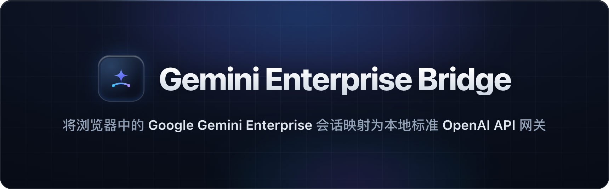
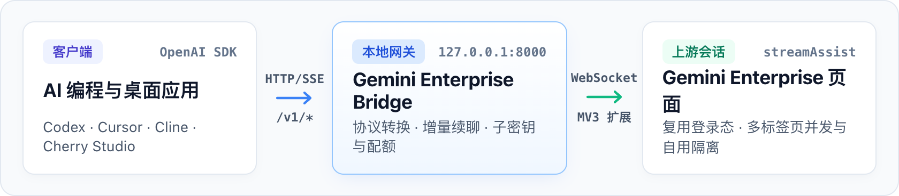
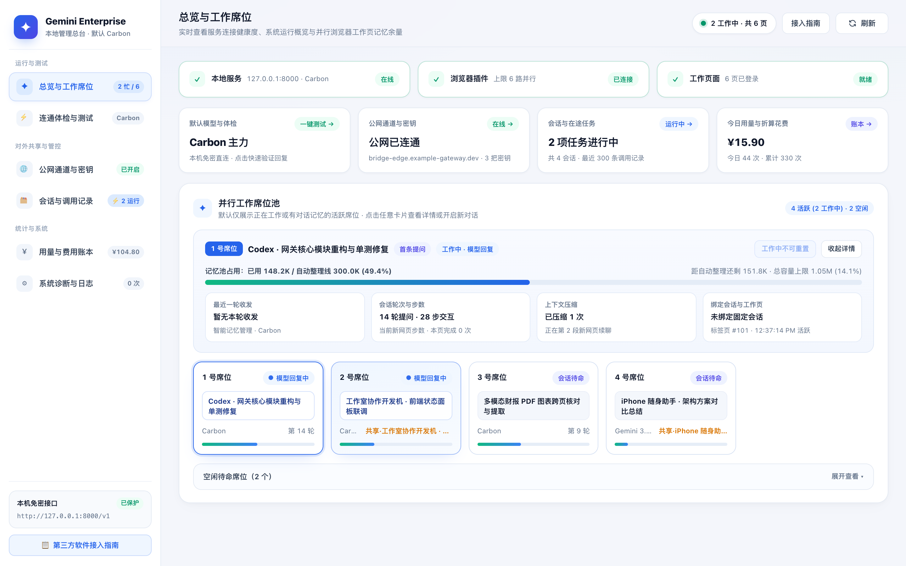
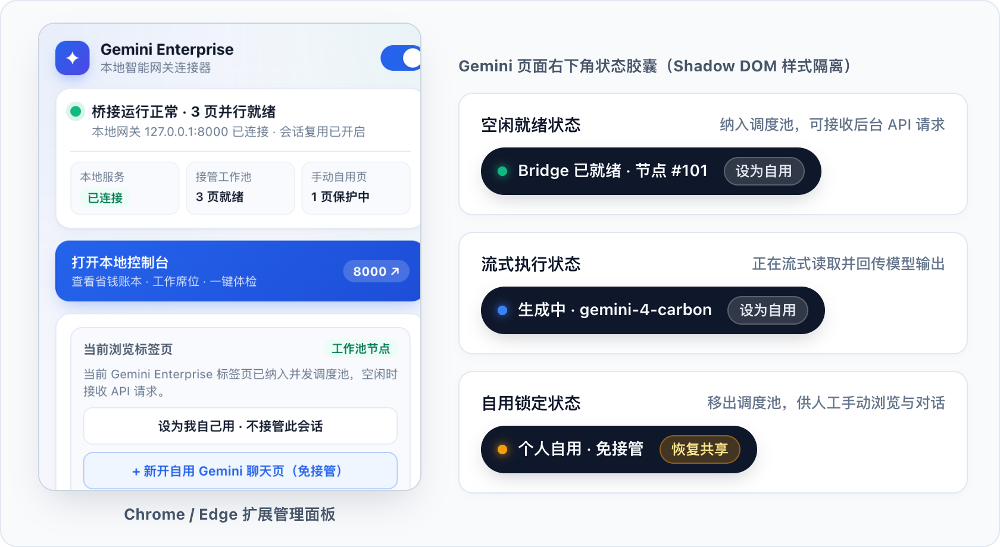
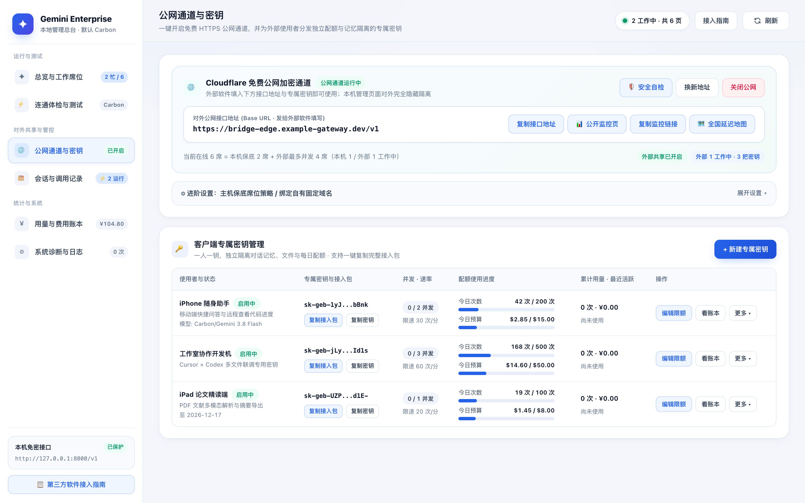
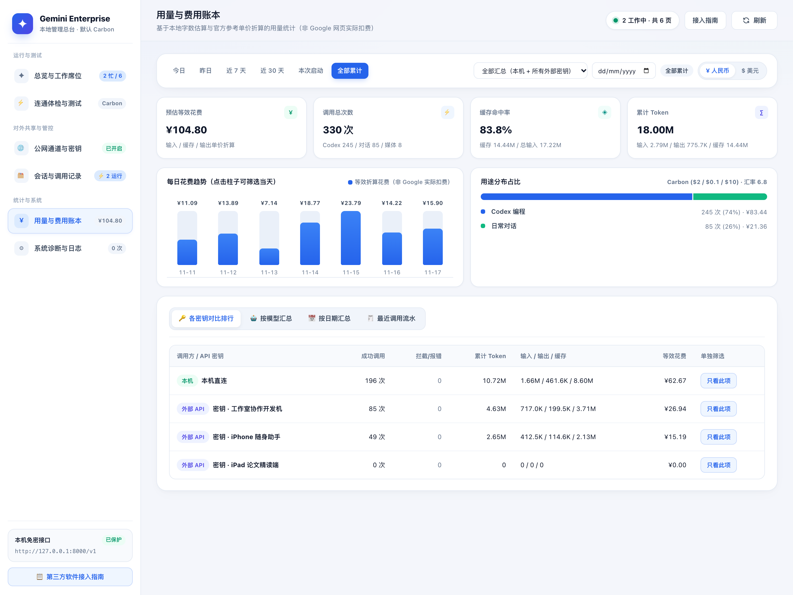
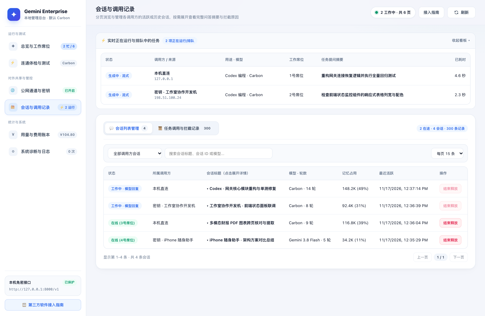

<div align="center">



<br />

[](#quickstart)
[](#requirements)
[](#extension-setup)
[](#api-routes)
[-D97706?style=for-the-badge&logo=googlegemini&logoColor=white)](#model-routing)
[](LICENSE)

<p align="center">
  <b>简体中文</b> · <a href="README_EN.md">English</a>
</p>

<p align="center">
  <a href="#overview">项目简介</a> ·
  <a href="#features">核心特性</a> ·
  <a href="#preview">界面预览</a> ·
  <a href="#quickstart">快速开始</a> ·
  <a href="#clients">客户端接入</a> ·
  <a href="#faq">常见问题</a> ·
  <a href="#reference">架构与接口参考</a>
</p>

</div>

---

<a id="overview"></a>

## 项目简介

**Gemini Enterprise Bridge** 是一个运行在本地的协议转换网关与浏览器扩展协同系统，用于将浏览器中已登录的 **Google Gemini Enterprise**（`vertexaisearch.cloud.google.com`）网页会话封装为标准的 **OpenAI API** 接口服务（同时兼容 `/v1/responses` 与 `/v1/chat/completions`）。

系统直接复用浏览器的登录状态与页面原生 `streamAssist` 数据通道，无需手动抓包提取 Cookie，也无需额外部署云端中转服务器。启动后，本机的 **Codex、Cursor、Cline、Cherry Studio、ChatBox** 以及标准的 OpenAI SDK 均可直接接入，调用 Gemini Enterprise 的百万 Token 上下文、多模态文件解析、联网检索以及原生图像与视频生成能力。

<p align="center">
  
</p>

---

<a id="features"></a>

## 核心特性

<table>
  <tr>
    <td width="50%" valign="top">
      <h4>OpenAI 双协议兼容</h4>
      <p>完整支持 <code>/v1/responses</code> 与 <code>/v1/chat/completions</code> 的流式（SSE）与非流式响应，兼容工具调用（Function Calling）、推理强度控制与结构化输出。</p>
    </td>
    <td width="50%" valign="top">
      <h4>多标签页并发与自用隔离</h4>
      <p>多个已登录标签页自动组成并发工作池，负载较高时可在后台自动扩容新标签页；支持在页面右下角将任意标签页标记为“个人自用”，避免后台任务干扰人工对话。</p>
    </td>
  </tr>
  <tr>
    <td width="50%" valign="top">
      <h4>原生百万上下文增量续聊</h4>
      <p>本地持久化维护请求上下文与网页端 <code>conversation_id</code> 的映射关系。多轮对话与工具结果回传仅发送增量内容，减少重复上下文传输并降低首字延迟。</p>
    </td>
    <td width="50%" valign="top">
      <h4>多模态文档解析与媒体生成</h4>
      <p>支持传入 PDF、Word、Excel、PPT、代码、音频、视频及常见图片（自动完成 HEIC / MOV 等格式转码），并支持将网页端原生生成的无水印原图与视频自动归档至本地。</p>
    </td>
  </tr>
  <tr>
    <td width="50%" valign="top">
      <h4>可视化管理控制台</h4>
      <p>内置本地 Web 管理界面（<code>http://127.0.0.1:8000/</code>），集中提供工作节点监控、连通性自检、在线对话测试、Token 用量与等价 API 费用统计，以及实时请求审计。</p>
    </td>
    <td width="50%" valign="top">
      <h4>公网隧道与多子密钥配额</h4>
      <p>内置 Cloudflare 加密公网隧道与休眠唤醒自动重连机制；支持签发独立的 <code>sk-geb-...</code> 子密钥并分别配置并发上限、日请求配额与有效期，同时提供 <code>/status</code> 公开状态页。</p>
    </td>
  </tr>
</table>

---

<a id="preview"></a>

## 界面预览

### 管理控制台与工作节点池

实时查看各浏览器工作标签页的在线状态、所属账号分组、活跃对话数与上下文复用统计，并可直接执行链路自检或在线对话验证。

<p align="center">
  
</p>

### 浏览器扩展与页面状态胶囊

扩展面板用于管理网关连接与工作池容量上限；Gemini Enterprise 页面右下角嵌入独立隔离的状态胶囊，可随时切换当前标签页是否参与 API 调度。

<p align="center">
  
</p>

### 公网隧道与子密钥配额管理

支持在控制台内一键启停 Cloudflare 公网隧道，按使用场景创建多把独立子密钥（限制并发数、每日请求量与过期时间），并复制客户端接入配置。

<p align="center">
  
</p>

<details>
  <summary><b>展开查看更多界面预览（公开服务状态页 / 用量与等价成本统计 / 实时请求审计）</b></summary>
  <br />

  <h4>公开服务状态页（<code>/status</code>）与全国多节点延迟检测</h4>
  <p>面向外部使用者的只读状态页，展示工作池负载、近 7 天可用率与全国多省份三网延迟实测结果，不包含任何敏感配置。</p>
  <p align="center">
    
  </p>

  <h4>Token 用量与等价 API 费用统计</h4>
  <p>基于本地 SQLite 持久化记录输入/输出 Token 与会话复用命中量，按模型维度折算等价官方 API 调用成本。</p>
  <p align="center">
    
  </p>

  <h4>实时请求追踪与错误日志审计</h4>
  <p>展示在途请求执行阶段、首字耗时（TTFT）、总耗时及近期请求明细，便于定位超时或上游异常。</p>
  <p align="center">
    
  </p>
</details>

---

<a id="quickstart"></a>

## 快速开始

<a id="requirements"></a>

### 环境要求

| 项目 | 要求说明 |
| :--- | :--- |
| **操作系统** | macOS、Windows 10 / 11 或 Linux |
| **Python** | Python `3.10` 及以上版本（首次运行启动脚本会自动创建 `.venv` 虚拟环境并安装依赖） |
| **浏览器** | Google Chrome、Microsoft Edge（推荐加载 MV3 扩展），或其他支持 Tampermonkey / Violentmonkey 的浏览器 |
| **账号权限** | 已开通并可在浏览器正常访问 Google Gemini Enterprise（`vertexaisearch.cloud.google.com`） |

### 1. 启动本地网关

克隆仓库后，根据当前操作系统执行对应的启动脚本：

**macOS / Linux**

```bash
git clone https://github.com/MagicalNobodee/Gemini-Enterprise-Responses-Bridge.git
cd Gemini-Enterprise-Responses-Bridge

# 自动初始化虚拟环境、同步扩展目录并启动本地网关
./start.sh
```

**Windows（CMD 或 PowerShell）**

直接双击运行仓库根目录下的 `start.bat`，或在 PowerShell 中使用守护脚本管理后台进程：

```powershell
# 启动后台守护进程（支持异常退出自动拉起与公网隧道连接自愈）
.\start.ps1 -Action start

# 查看服务与隧道当前运行状态
.\start.ps1 -Action status

# 停止后台服务
.\start.ps1 -Action stop
```

服务启动后默认监听以下本地地址：

- **Web 管理控制台**：`http://127.0.0.1:8000/`
- **OpenAI 兼容 API 入口**：`http://127.0.0.1:8000/v1`
- **公开只读状态页**：`http://127.0.0.1:8000/status`

<a id="extension-setup"></a>

### 2. 加载浏览器扩展

1. 在 Chrome 或 Edge 地址栏访问 `chrome://extensions`（Edge 可访问 `edge://extensions`），开启右上角的**开发者模式**。
2. 点击左上角**加载已解压的扩展程序**，选择本项目根目录下的 `extension` 文件夹。
3. 在浏览器中打开 `https://vertexaisearch.cloud.google.com` 并完成企业账号登录。

当页面右下角状态胶囊或管理控制台显示节点**已就绪**时，本地 API 即可正常接收请求。

<details>
  <summary>备选方案：通过 Userscript（Tampermonkey / Violentmonkey）接入</summary>
  <br />
  若当前浏览器环境不便加载解压扩展，可先运行 <code>python3 sync_extension.py</code> 生成最新脚本，再将仓库根目录下的 <code>gemini-enterprise-bridge.user.js</code> 导入油猴扩展并刷新 Gemini Enterprise 页面。在多标签页调度、后台自动扩缩容与原生请求流读取方面，建议优先使用 Chrome / Edge 扩展方案。
</details>

---

<a id="clients"></a>

## 客户端接入

### 连接参数与常用模型

在支持自定义 OpenAI 接口的客户端中填入以下参数即可使用：

| 参数项 | 本地接入默认值 | 说明 |
| :--- | :--- | :--- |
| **Base URL** | `http://127.0.0.1:8000/v1` | 若通过公网隧道远程访问，请替换为控制台显示的 `https://xxx.trycloudflare.com/v1` |
| **API Key** | 任意非空字符串（如 `sk-local`） | 本机回环请求默认免密放行；公网访问必须填写主密钥或控制台签发的 `sk-geb-...` 子密钥 |
| **协议类型** | OpenAI Responses 或 Chat Completions | Codex 等工具建议使用 `responses`；常规对话客户端使用默认的 `chat/completions` 即可 |

常用模型 ID 如下（完整后缀修饰符见后文[模型路由与参数修饰符](#model-routing)）：

| 模型 ID | 定位与适用场景 |
| :--- | :--- |
| `gemini-4-carbon` | 默认主力模型（1M 上下文），兼顾代码工程、多模态理解与响应速度 |
| `gemini-4-argon` | 深度推理模型，适合复杂架构设计、数学推导与疑难缺陷定位 |
| `gemini-3.1-pro` | 通用均衡模型，适合常规长文档分析与综合问答 |
| `gemini-3.8-flash` | 轻量低延迟模型，适合高频交互、摘要提取与快速检索 |
| `gemini-enterprise` | 跟随当前网页标签页已选模型，不做强制切换 |

### Codex CLI / Codex App 配置

- **同步百万上下文模型目录**：运行以下命令可自动备份现有配置并将 1M 上下文参数写入本地 Codex 配置：
  ```bash
  ./.venv/bin/python configure_codex_context.py --apply
  # Windows PowerShell 可运行：.\start.ps1 -EnsureCodexProfile
  ```
- **多供应商同菜单模型分流（可选）**：若希望在 Codex 模型下拉菜单中同时保留原有供应商模型与本地 Gemini 模型（按模型名称或前缀规则自动分流并隔离上游密钥），可安装内置分流器：
  ```bash
  ./.venv/bin/python codex_model_router/install_router.py --apply
  ```
  详细配置说明见 [docs/CODEX_MODEL_ROUTER.md](docs/CODEX_MODEL_ROUTER.md) 与 [codex_model_router/AGENTS.global.example.md](codex_model_router/AGENTS.global.example.md)。

### Cursor / Cline / Cherry Studio / ChatBox 配置

1. 在客户端模型设置中选择 **OpenAI Compatible（自定义 OpenAI 兼容接口）**。
2. 将 API 地址设为 `http://127.0.0.1:8000/v1`（注意部分客户端会自动拼接 `/v1`，可在管理控制台的“软件接入指南”页核对各客户端的具体填法）。
3. 手动添加或通过客户端“获取模型列表”拉取 `gemini-4-carbon`、`gemini-4-argon` 等模型 ID 后即可开始对话。

---

<a id="faq"></a>

## 常见问题

<details>
  <summary><b>后台 API 调用是否会干扰我正在浏览器中手动进行的对话？</b></summary>
  <br />
  不会。点击任意 Gemini Enterprise 页面右下角状态胶囊上的<b>「设为自用」</b>（或在扩展弹窗中点击<b>「+ 新开自用 Gemini 聊天页」</b>），该标签页即会被标记为免接管状态（状态胶囊变为琥珀色），并在扩展存储中持久化保留，后台任务调度器不会向该页面分配任何 API 请求。
</details>

<details>
  <summary><b>如何提高并发处理能力，或同时接入多个企业账号？</b></summary>
  <br />
  在浏览器中多打开几个 Gemini Enterprise 标签页即可线性提升并发度；也在扩展弹窗中开启<b>「繁忙时自动多开」</b>并设置标签页上限（如 6 页或 8 页）。如需挂载多个企业账号，使用 Chrome / Edge 的多个独立用户配置（Profile）分别登录并加载同一份 <code>extension</code> 目录，网关会自动按账号分组管理所有节点。
</details>

<details>
  <summary><b>开启公网隧道后如何保障接口安全？系统休眠唤醒后连接中断如何处理？</b></summary>
  <br />
  网关实行本机与公网差异化鉴权策略：凡带有公网转发请求头（如 <code>Cf-Connecting-Ip</code>、<code>X-Forwarded-For</code>）或非回环来源的请求，均强制校验 API 密钥；未配置密钥时公网请求会被直接拒绝（<code>HTTP 401</code>）。建议对外分发具有并发、日配额和到期时间限制的 <code>sk-geb-...</code> 子密钥。此外，后台内置隧道健康巡检，系统休眠唤醒后会自动重连；Windows 环境异常排查可参考 <a href="WINDOWS_TUNNEL_RECOVERY.md">WINDOWS_TUNNEL_RECOVERY.md</a>。
</details>

<details>
  <summary><b>开启全局代理或虚拟网卡（Clash / Surge / TUN 模式）时需要注意什么？</b></summary>
  <br />
  浏览器访问 Google Gemini Enterprise 网页遵循浏览器自身的网络环境；本机客户端与 <code>127.0.0.1:8000</code> 之间的通信走本地回环网卡，代码内部已为本地探测禁用系统代理环境变量。若代理客户端开启了严格接管回环流量的规则，确保 <code>127.0.0.1</code> 与 <code>localhost</code> 处于直连（DIRECT）列表即可。
</details>

<details>
  <summary><b>拉取最新代码后如何更新本地环境与浏览器扩展？</b></summary>
  <br />
  网关在后台连接建立时支持向扩展热推送最新页面驱动脚本（<code>page-driver.js</code>）。若更新涉及扩展清单或后台脚本（<code>manifest.json</code> / <code>background.js</code> / <code>popup.*</code>），重新执行一次 <code>./start.sh</code>（或 <code>python3 sync_extension.py</code>），随后在 <code>chrome://extensions</code> 页面点击扩展卡片上的刷新按钮即可生效。
</details>

---

<a id="reference"></a>

## 架构与接口参考

### 系统架构

```text
┌──────────────────────────────────────────────────────────────────────────────┐
│  AI Clients & SDKs                                                           │
│  Codex CLI/App · Cursor · Cline · Cherry Studio · OpenAI Python/Node SDK     │
└──────────────────────────────────────┬───────────────────────────────────────┘
                                       │ HTTP / SSE (OpenAI Responses & Chat)
                                       ▼
┌──────────────────────────────────────────────────────────────────────────────┐
│  FastAPI Local Gateway (server.py · 127.0.0.1:8000)                          │
│  ├─ Protocol Layer : /v1/responses · /v1/chat/completions · /v1/images/*     │
│  ├─ Context Engine : conversation_id reuse · Incremental delta · Retry/Heal  │
│  ├─ Media Pipeline : PDF/Office/Audio/Video staging · HEIC/MOV transcoding   │
│  ├─ Auth & Tunnel  : Sub-keys (sk-geb-*) · Quota/Concurrency · Cloudflared   │
│  └─ Storage & UI   : SQLite WAL ledger · Audit ring · Dashboard & /status    │
└──────────────────────────────────────┬───────────────────────────────────────┘
                                       │ Local WebSocket (/ws/browser)
                                       ▼
┌──────────────────────────────────────────────────────────────────────────────┐
│  Browser Extension Pool (MV3 Extension / Userscript)                         │
│  ├─ background.js     : Multi-tab worker pool · Auto-spawn · Driver hot-sync │
│  ├─ content-bridge.js : ISOLATED world relay · Closed Shadow DOM status pill │
│  └─ page-driver.js    : MAIN world native streamAssist capture & UI control  │
└──────────────────────────────────────┬───────────────────────────────────────┘
                                       │ Browser Authenticated Session
                                       ▼
┌──────────────────────────────────────────────────────────────────────────────┐
│  Google Gemini Enterprise Web (vertexaisearch.cloud.google.com)              │
│  Carbon (1M) · Argon · 3.1 Pro · 3.8 Flash · Web Search · Imagen · Veo       │
└──────────────────────────────────────────────────────────────────────────────┘
```

### 核心技术机制

1. **MAIN / ISOLATED 双执行世界桥接与原生流读取**
   - 扩展通过 `content-bridge.js`（ISOLATED 世界）维护安全中继与闭合 Shadow DOM 状态胶囊；由 `page-driver.js`（MAIN 世界）挂钩页面原生 `streamAssist` 流式响应，直接提取完整 Markdown 文本、思维链摘要（Reasoning Summary）、联网引用溯源以及生成的无水印原图与视频资源，并在 DOM 采集结果截断时自动择优合并。
2. **服务端会话状态机与异常自愈**
   - `session_store.py` 持久化记录客户端消息前缀哈希、工具调用历史与网页端 `conversation_id` 及节点槽位（`slot_id`）的绑定关系。命中已有会话时仅向该槽位发送增量输入；遇到网页端会话失效、模型切换冲突或节点离线时，自动切换可用槽位并回退为完整历史摘要重放。
3. **工具调用协议转换与输出净化**
   - `tool_calling.py` 与 `context_builder.py` 将 OpenAI 函数定义（JSON Schema）编译为结构化工具协议，通过流式状态机实时识别工具调用块并转化为标准 `response.output_item.added`（`function_call`）或 `tool_calls` 增量事件；`reply_integrity.py` 自动剥离内部思考标记与多余协议围栏。
4. **多模态文件预处理管线**
   - 支持 Base64 Data URL、远程 URL 与 `/v1/files` 文件引用。网关自动借助 macOS `sips` 或 `ffmpeg` 将浏览器原生不支持的 `HEIC/HEIF`、`TIFF/BMP`、`MOV/AVI/MKV` 转码为标准 `JPEG`/`MP4` 后再注入网页上传控件。
5. **SQLite WAL 计量存储与多子密钥限流**
   - `usage_ledger.py` 与 `key_store.py` 基于 SQLite WAL 模式持久化记录每次请求的输入/缓存命中/输出 Token、关联子密钥与等价官方 API 成本；支持细粒度的每密钥并发信号量与自然日配额控制。
6. **跨平台进程与编码兼容**
   - `platform_compat.py` 封装了 POSIX `fcntl` 与 Windows `msvcrt` 文件锁、终端 UTF-8/GBK 解码容错、进程树清理以及 `cloudflared` 二进制自动探测，保障 macOS、Windows 与 Linux 行为一致。

<a id="model-routing"></a>

### 模型路由与参数修饰符

网关支持在基础模型 ID 后拼接修饰符，以在单次请求中指定推理强度或联网行为：

| 模型 ID / 组合写法示例 | 映射目标与行为说明 |
| :--- | :--- |
| `gemini-4-carbon`（默认） | 映射网页端 **Carbon** 模型（1M 上下文，通用编码与多模态主力） |
| `gemini-4-argon` | 映射网页端 **Argon** 模型（深度推理与复杂逻辑分析） |
| `gemini-3.1-pro` | 映射网页端 **3.1 Pro** 模型 |
| `gemini-3.8-flash` / `gemini-auto` | 映射网页端 **3.8 Flash** 或 **Auto** 自动档位 |
| `gemini-enterprise` | 保持当前工作标签页已选模型不变 |
| `*-nothinking` / `*-minimal` / `*-low` / `*-medium` / `*-high` / `*-xhigh` | 显式覆盖推理强度（同 `reasoning.effort` 或 `reasoning_effort` 参数），例如 `gemini-4-argon-high` |
| `*-search` | 强制注入实时联网检索与来源核验约束，例如 `gemini-4-carbon-search` |

> 在控制台开启 `BRIDGE_GCLOUD_FALLBACK` 并配置本地 `gcloud` 凭据后，也可通过 `gcloud/<model-id>` 直接调用 Google Cloud Vertex AI 官方接口。

### SDK 调用示例

#### 1. OpenAI Responses API（流式输出与多轮会话复用）

```python
from openai import OpenAI

client = OpenAI(
    base_url="http://127.0.0.1:8000/v1",
    api_key="sk-local",
)

# 首轮请求
stream = client.responses.create(
    model="gemini-4-carbon",
    input="请用三点概括 Raft 一致性算法中 Leader 选举的核心约束。",
    stream=True,
)

resp_id = None
for event in stream:
    if event.type == "response.created":
        resp_id = event.response.id
    elif event.type == "response.output_text.delta":
        print(event.delta, end="", flush=True)

# 基于 previous_response_id 进行增量续聊
followup = client.responses.create(
    model="gemini-4-carbon",
    previous_response_id=resp_id,
    input="如果发生网络分区导致脑裂，任期号（Term）如何保证安全性？",
)
print("\n\n--- 续聊回复 ---\n", followup.output_text)
```

#### 2. Chat Completions API（工具调用 Function Calling）

```python
from openai import OpenAI

client = OpenAI(base_url="http://127.0.0.1:8000/v1", api_key="sk-local")

tools = [
    {
        "type": "function",
        "function": {
            "name": "query_service_latency",
            "description": "查询指定可用区的实时 P99 延迟（毫秒）",
            "parameters": {
                "type": "object",
                "properties": {"region": {"type": "string"}},
                "required": ["region"],
            },
        },
    }
]

resp = client.chat.completions.create(
    model="gemini-4-carbon",
    messages=[{"role": "user", "content": "帮我查一下 ap-east-1 区域的当前延迟。"}],
    tools=tools,
)
print(resp.choices[0].message)
```

#### 3. 多模态文档分析与原生图像生成

```python
from pathlib import Path
from openai import OpenAI

client = OpenAI(base_url="http://127.0.0.1:8000/v1", api_key="sk-local")

# 上传本地 PDF 并直接提问
uploaded = client.files.create(file=Path("report.pdf"), purpose="user_data")
doc_resp = client.responses.create(
    model="gemini-4-carbon",
    input=[
        {
            "role": "user",
            "content": [
                {"type": "input_file", "file_id": uploaded.id},
                {"type": "input_text", "text": "提取文档中的关键财务指标并整理为 Markdown 表格。"},
            ],
        }
    ],
)
print(doc_resp.output_text)

# 调用图像生成接口
img = client.images.generations.create(
    model="gemini-4-carbon",
    prompt="Minimalist architectural glass pavilion at dusk, warm interior lighting, 8k photorealistic",
    response_format="url",
)
print("图像地址:", img.data[0].url)
```

<a id="api-routes"></a>

### API 路由列表

| 分类 | 方法与路径 | 功能说明 |
| :--- | :--- | :--- |
| **OpenAI 标准接口** | `GET /v1/models` | 返回可用模型及修饰符变体列表 |
| | `POST /v1/responses` | OpenAI Responses 接口（支持流式 SSE、`previous_response_id`、多模态与工具调用） |
| | `POST /v1/chat/completions` | OpenAI Chat Completions 接口（支持流式 SSE、多模态与工具调用） |
| | `POST /v1/images/generations` | 文生图接口（支持返回 `b64_json` 或本地 `/media/...` URL） |
| | `POST /v1/images/edits` | 图生图 / 局部重绘接口（`multipart/form-data`） |
| | `POST /v1/files` · `GET /v1/files` | 预上传多模态文件、查询或删除缓存文件 |
| **可视化页面与静态资源** | `GET /` · `GET /dashboard` | 本地 Web 管理控制台 |
| | `GET /status` | 公开只读服务状态与多地域延迟测速页 |
| | `GET /media/{filename}` | 访问归档保存的原图或视频文件 |
| **控制台管理接口** | `GET /api/status` · `GET /health` | 查询网关状态、节点池负载、会话缓存与隧道信息 |
| | `POST /api/selftest` · `POST /api/playground` | 执行端到端链路自检或控制台在线测试 |
| | `GET /api/usage` · `GET /api/audit` | 读取 Token 用量账本与实时请求审计日志 |
| | `GET /api/keys` · `POST /api/keys` | 查询、签发、修改或吊销 `sk-geb-...` 子密钥 |
| | `POST /api/tunnel/start` · `stop` · `install` | 启停或自动安装 `cloudflared` 公网隧道 |
| | `GET /api/public/status` · `china-ping` | 公开脱敏状态数据与全国节点延迟探测接口 |
| **扩展内部通信** | `WS /ws/browser` | 浏览器扩展与本地网关之间的双向 WebSocket 通道 |

### 环境变量配置

首次运行 `./start.sh` 或 `start.bat` 时，若根目录不存在 `.env`，会自动根据 `env.example` 生成默认配置。常用配置项如下：

| 变量名 | 默认值 | 说明 |
| :--- | :--- | :--- |
| `BRIDGE_HOST` / `BRIDGE_PORT` | `127.0.0.1` / `8000` | 本地网关监听地址与端口 |
| `BRIDGE_API_KEY` | 空（本机免密） | 网关主密钥；公网转发请求始终强制要求主密钥或有效子密钥 |
| `BRIDGE_DEFAULT_MODEL` | `gemini-4-carbon` | 客户端未指定模型或传入通用别名时的默认目标模型 |
| `BRIDGE_REQUEST_TIMEOUT` | `600` | 单次生成请求的最大超时时间（秒） |
| `BRIDGE_ENABLE_SESSION_REUSE` | `true` | 是否开启多轮对话 `conversation_id` 增量续聊 |
| `BRIDGE_USD_TO_CNY` | `7.20` | 用量统计面板的美元兑人民币折算汇率 |
| `BRIDGE_TUNNEL_AUTOSTART` | `false` | 启动网关时是否自动拉起 Cloudflare 公网隧道 |
| `BRIDGE_TUNNEL_HOSTNAME` | 空（随机域名） | 绑定自有 Cloudflare Named Tunnel 固定域名时填写 |

### 目录结构与自动化测试

```text
Gemini-Enterprise-Responses-Bridge/
├── server.py                          # FastAPI 网关主入口、路由编排与管理 API
├── browser_pool.py                    # 多标签页工作池调度、账号亲和性与自动扩容
├── context_builder.py                 # 消息编译、增量计算、多模态与媒体转码管线
├── tool_calling.py                    # OpenAI 工具协议编解码与流式状态机
├── session_store.py                   # 多轮会话哈希与 conversation_id 映射存储
├── usage_ledger.py                    # SQLite WAL 用量与等价费用统计模块
├── key_store.py                       # 多子密钥（sk-geb-*）签发、并发与日配额控制
├── tunnel_manager.py                  # Cloudflare 隧道生命周期管理与断线自愈
├── dashboard_html.py                  # Web 管理控制台与 /status 公开状态页前端
├── platform_compat.py                 # 跨平台文件锁、字符编码与进程管理兼容层
├── configure_codex_context.py         # Codex 1M 上下文参数与模型目录同步脚本
├── codex_model_router/                # Codex 多供应商同菜单模型分流器与安装工具
├── background.js                      # MV3 扩展后台（标签页池管理、自用隔离、热同步）
├── content-bridge.js                  # ISOLATED 世界消息中继与右下角状态胶囊
├── page-driver.js                     # MAIN 世界原生 streamAssist 流捕获与页面驱动
├── popup.html / popup.css / popup.js  # 浏览器扩展弹窗界面
├── sync_extension.py                  # 同步打包 extension/ 目录与 Userscript 脚本
├── start.sh / start.bat / start.ps1   # macOS / Linux / Windows 启动与守护脚本
└── test_*.py / test_*.mjs             # Python 与 Node.js 自动化回归测试集
```

运行自动化回归测试：

```bash
# 运行 Python 网关、协议转换、会话复用与子密钥限流测试
./.venv/bin/pytest -q

# 导出最新扩展产物并运行前端与驱动脚本测试
python3 sync_extension.py
node test_page_driver_Logic.mjs
node test_background_Logic.mjs
node test_dashboard_Logic.mjs
```

### 免责声明与开源许可

- **合规使用说明**：本项目仅作为本地开发辅助工具，用于将用户自身合法持有的浏览器会话转换为标准本地接口。请遵守所在机构的管理规定以及 Google 服务条款，合理控制请求频率。
- **数据隐私边界**：所有会话映射、用量记录、媒体缓存与子密钥哈希均仅存储在用户本机目录（`.cache/`）中，不包含任何第三方遥测或数据上报逻辑。
- **开源许可**：本项目基于 [MIT License](LICENSE) 协议开源。
