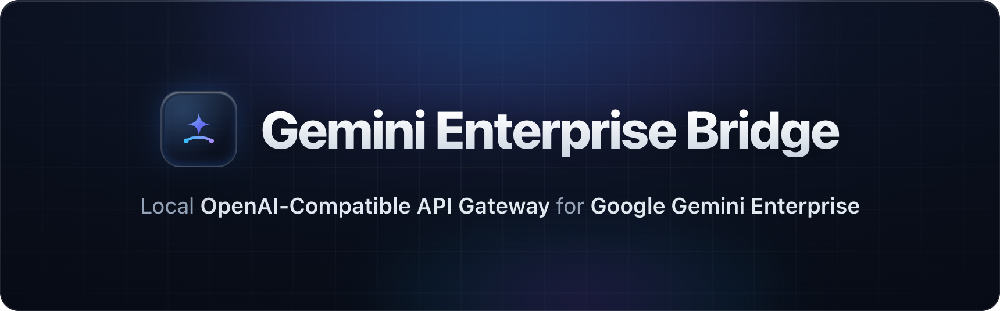
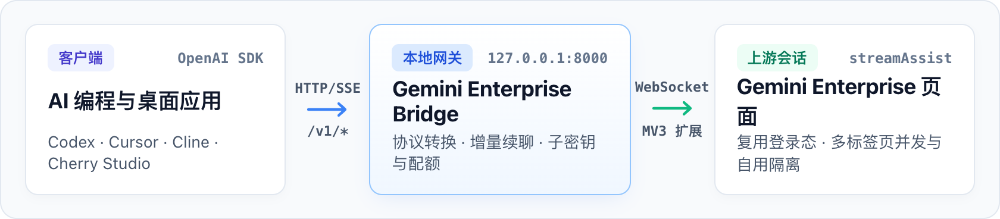
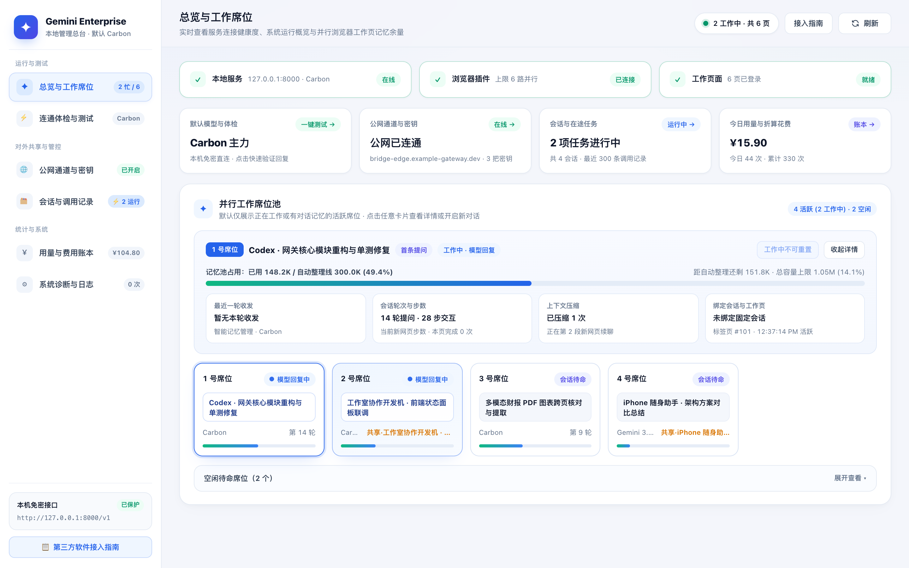
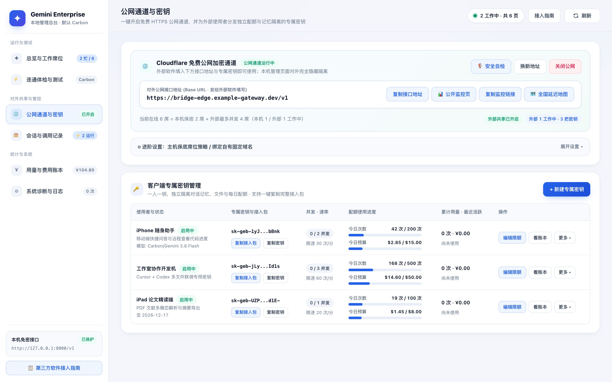
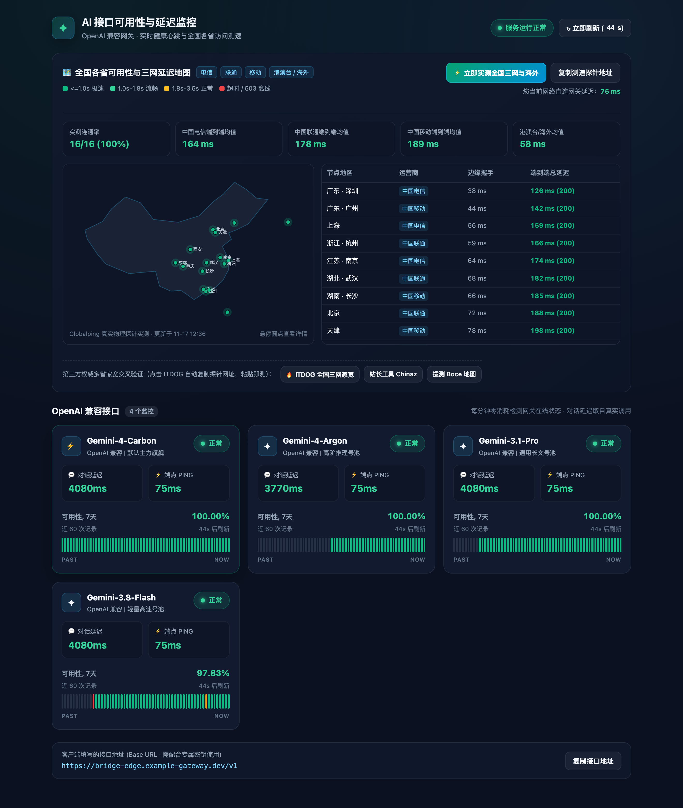
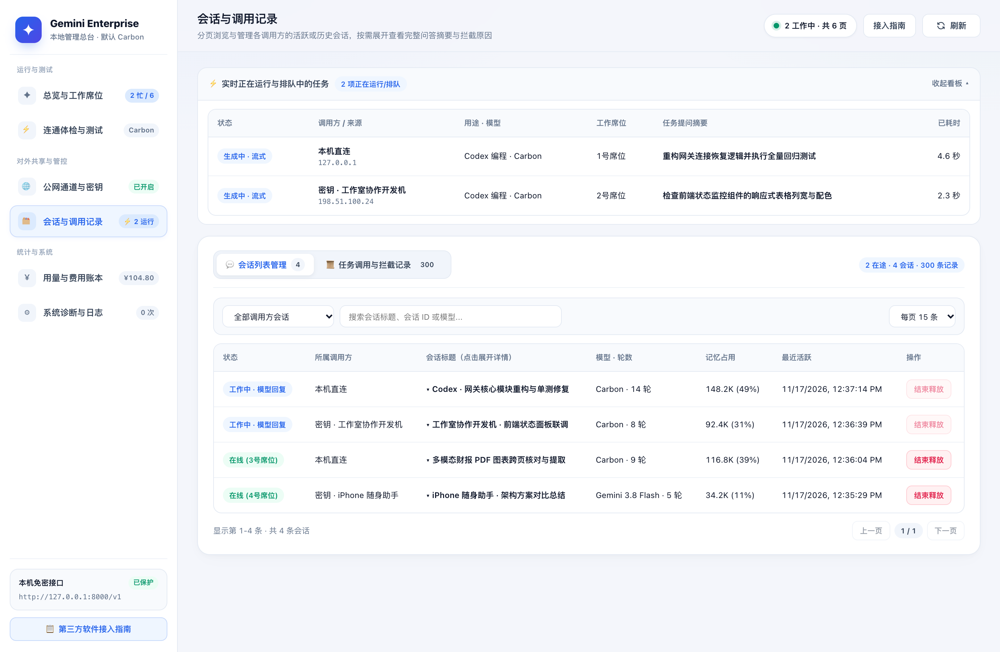

<div align="center">



<br />

[](#quickstart)
[](#requirements)
[](#extension-setup)
[](#api-routes)
[-D97706?style=for-the-badge&logo=googlegemini&logoColor=white)](#model-routing)
[](LICENSE)

<p align="center">
  <a href="README.md">简体中文</a> · <b>English</b>
</p>

<p align="center">
  <a href="#overview">Overview</a> ·
  <a href="#features">Key Features</a> ·
  <a href="#preview">Interface Preview</a> ·
  <a href="#quickstart">Quick Start</a> ·
  <a href="#clients">Client Setup</a> ·
  <a href="#reference">Architecture & API Reference</a>
</p>

</div>

---

<a id="overview"></a>

## Overview

**Gemini Enterprise Bridge** is a local protocol gateway and browser extension system that exposes authenticated **Google Gemini Enterprise** (`vertexaisearch.cloud.google.com`) web sessions as a standard **OpenAI-compatible API** (`/v1/responses` and `/v1/chat/completions`).

By operating through your existing browser session and native `streamAssist` transport, it requires no manual cookie extraction and no external relay server. Local developer tools and desktop clients—including **Codex CLI / App, Cursor, Cline, Cherry Studio, ChatBox**, and standard OpenAI SDKs—can directly leverage Gemini Enterprise's 1M-token context window, multimodal document analysis, web grounding, and native image/video generation.

<p align="center">
  
</p>

---

<a id="features"></a>

## Key Features

<table>
  <tr>
    <td width="50%" valign="top">
      <h4>Dual OpenAI API Compatibility</h4>
      <p>Implements both <code>/v1/responses</code> and <code>/v1/chat/completions</code> (streaming SSE and non-streaming JSON), with full support for Function Calling, reasoning effort controls, and structured outputs.</p>
    </td>
    <td width="50%" valign="top">
      <h4>Multi-Tab Worker Pool & Personal Tab Isolation</h4>
      <p>Schedules concurrent requests across multiple logged-in tabs with automatic background tab scaling under load. Any tab can be marked as personal-only via the bottom-right status pill so background API jobs never touch manual chats.</p>
    </td>
  </tr>
  <tr>
    <td width="50%" valign="top">
      <h4>Stateful 1M-Token Session Reuse</h4>
      <p>Persists mappings between client message prefixes and upstream <code>conversation_id</code>s, transmitting only incremental deltas on multi-turn chats and tool round-trips to minimize latency.</p>
    </td>
    <td width="50%" valign="top">
      <h4>Multimodal File Pipeline & Native Media</h4>
      <p>Accepts PDFs, Office documents, audio, video, and images (with automatic local transcoding for Apple HEIC/MOV formats), and archives full-resolution generated images and videos locally.</p>
    </td>
  </tr>
  <tr>
    <td width="50%" valign="top">
      <h4>Local Management Console</h4>
      <p>Built-in Web dashboard at <code>http://127.0.0.1:8000/</code> for worker health monitoring, end-to-end self-tests, interactive playground testing, token & equivalent API cost tracking, and live request auditing.</p>
    </td>
    <td width="50%" valign="top">
      <h4>Cloudflare Tunnel & Scoped Sub-Keys</h4>
      <p>Integrated one-click Cloudflare Quick Tunnel with sleep/wake auto-recovery, scoped <code>sk-geb-...</code> sub-keys (per-key concurrency, daily request caps, expiration), and a read-only <code>/status</code> page.</p>
    </td>
  </tr>
</table>

---

<a id="preview"></a>

## Interface Preview

### Management Console & Worker Pool

Monitor connected browser tabs, account groups, active conversations, and session reuse hit rates, or run one-click diagnostics.

<p align="center">
  
</p>

### Browser Extension & Shadow DOM Status Pill

Configure worker pool limits from the extension popup, and toggle individual Gemini tabs between API worker mode and personal manual-chat mode.

<p align="center">
  
</p>

### Public Tunnel & Sub-Key Quota Controls

Manage Cloudflare HTTPS tunnels and issue scoped `sk-geb-...` sub-keys with independent concurrency limits, daily quotas, and expiration dates.

<p align="center">
  
</p>

<details>
  <summary><b>More Interface Previews (Public Status Page / Usage Ledger / Live Request Audit)</b></summary>
  <br />

  <h4>Public Service Status Page (<code>/status</code>)</h4>
  <p align="center">
    
  </p>

  <h4>Token Usage & Equivalent API Cost Ledger</h4>
  <p align="center">
    
  </p>

  <h4>Live Request Audit & Diagnostics</h4>
  <p align="center">
    
  </p>
</details>

---

<a id="quickstart"></a>

## Quick Start

<a id="requirements"></a>

### Requirements

| Component | Requirement |
| :--- | :--- |
| **OS** | macOS, Windows 10 / 11, or Linux |
| **Python** | Python `3.10+` (virtual environment and dependencies are provisioned automatically on first launch) |
| **Browser** | Google Chrome or Microsoft Edge (MV3 extension recommended; Userscript fallback included) |
| **Account** | Active browser access to Google Gemini Enterprise (`vertexaisearch.cloud.google.com`) |

### 1. Start the Local Gateway

**macOS / Linux**

```bash
git clone https://github.com/MagicalNobodee/Gemini-Enterprise-Responses-Bridge.git
cd Gemini-Enterprise-Responses-Bridge
./start.sh
```

**Windows (CMD / PowerShell)**

Double-click `start.bat`, or manage background execution in PowerShell:

```powershell
.\start.ps1 -Action start
.\start.ps1 -Action status
.\start.ps1 -Action stop
```

Default local endpoints:
- **Management Console**: `http://127.0.0.1:8000/`
- **OpenAI API Base URL**: `http://127.0.0.1:8000/v1`
- **Public Status Page**: `http://127.0.0.1:8000/status`

<a id="extension-setup"></a>

### 2. Load the Browser Extension

1. Open `chrome://extensions` (or `edge://extensions`) and enable **Developer mode**.
2. Click **Load unpacked** and select the `extension` folder inside this repository.
3. Visit `https://vertexaisearch.cloud.google.com` and sign in with your enterprise account.

---

<a id="clients"></a>

## Client Setup

- **Base URL**: `http://127.0.0.1:8000/v1` (or your `https://xxx.trycloudflare.com/v1` tunnel URL for remote clients)
- **API Key**: Any non-empty string (e.g. `sk-local`) for localhost when `BRIDGE_API_KEY` is blank; remote tunnel traffic strictly requires the master key or an active `sk-geb-...` sub-key
- **Primary Models**: `gemini-4-carbon` (default 1M context), `gemini-4-argon` (deep reasoning), `gemini-3.1-pro`, `gemini-3.8-flash`, `gemini-enterprise`
- **Codex 1M Context Sync**: Run `./.venv/bin/python configure_codex_context.py --apply` (or `.\start.ps1 -EnsureCodexProfile` on Windows)
- **Codex Multi-Provider Model Router (Optional)**: Keep your existing provider models and local Gemini models side-by-side in a single Codex model menu via `./.venv/bin/python codex_model_router/install_router.py --apply`. See [docs/CODEX_MODEL_ROUTER.md](docs/CODEX_MODEL_ROUTER.md), [AGENTS.md](AGENTS.md), and [codex_model_router/AGENTS.global.example.md](codex_model_router/AGENTS.global.example.md).

---

<a id="reference"></a>

## Architecture & API Reference

<a id="model-routing"></a>

### Model Routing & Modifiers

| Model Slug / Suffix Pattern | Target & Behavior |
| :--- | :--- |
| `gemini-4-carbon` (Default) | Maps to **Carbon** (1M context window, primary coding & multimodal model) |
| `gemini-4-argon` | Maps to **Argon** (deep reasoning & complex architecture analysis) |
| `gemini-3.1-pro` / `gemini-3.8-flash` / `gemini-auto` | Maps to **3.1 Pro**, **3.8 Flash**, or **Auto** |
| `gemini-enterprise` | Uses the currently selected model in the worker tab without switching |
| `*-nothinking` / `*-minimal` / `*-low` / `*-medium` / `*-high` / `*-xhigh` | Overrides reasoning effort (e.g. `gemini-4-argon-high`) |
| `*-search` | Enforces live web search and source verification (e.g. `gemini-4-carbon-search`) |

<a id="api-routes"></a>

### API Endpoints

| Category | Endpoint | Description |
| :--- | :--- | :--- |
| **OpenAI Compatible** | `GET /v1/models` | List available models and modifier variants |
| | `POST /v1/responses` | OpenAI Responses API (SSE streaming, `previous_response_id`, multimodal, tools) |
| | `POST /v1/chat/completions` | OpenAI Chat Completions API (SSE streaming, multimodal, tools) |
| | `POST /v1/images/generations` · `edits` | Native image generation and editing |
| | `POST /v1/files` · `GET /v1/files` | Multimodal file staging and management |
| **Console & Operations** | `GET /` · `GET /status` | Local management console & public read-only status page |
| | `GET /api/status` · `GET /api/usage` · `GET /api/audit` | Worker pool status, SQLite usage ledger, and live audit ring |
| | `GET /api/keys` · `POST /api/keys` | Issue, update, or revoke `sk-geb-...` sub-keys |
| | `POST /api/tunnel/start` · `stop` · `install` | Cloudflare Quick Tunnel lifecycle management |

### Verification & License

```bash
./.venv/bin/pytest -q
python3 sync_extension.py
node test_page_driver_Logic.mjs
node test_background_Logic.mjs
node test_dashboard_Logic.mjs
```

Released under the [MIT License](LICENSE). All session caches, usage ledgers, staged files, and key hashes remain strictly on your local machine (`.cache/`).
