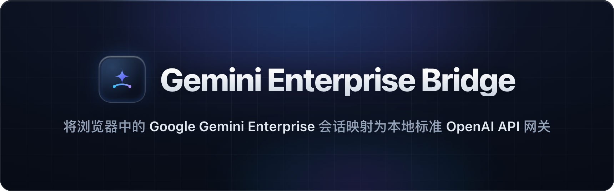
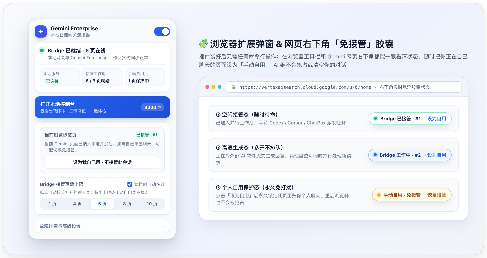
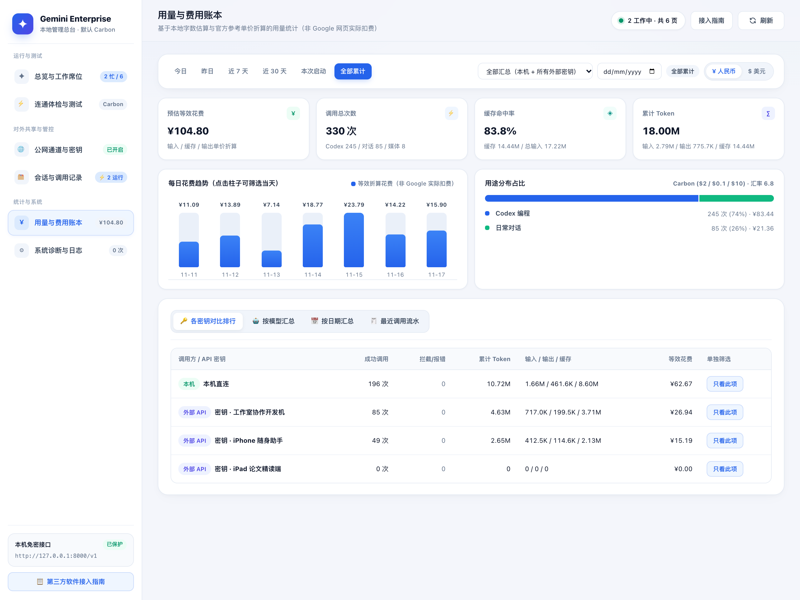
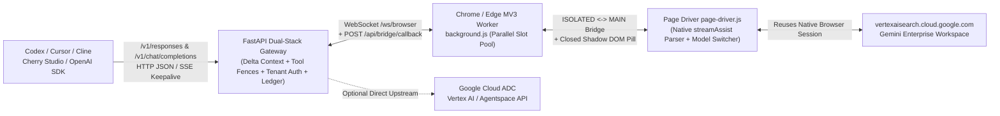

<div align="center">



<br />

[](#quickstart)
[](#requirements)
[](#extension-setup)
[](#api-routes)
[-D97706?style=for-the-badge&logo=googlegemini&logoColor=white)](#model-routing)
[](LICENSE)

<p align="center">
  <a href="README.md">简体中文</a> · <b>English</b>
</p>

<p align="center">
  <a href="#overview">✨ Overview</a> ·
  <a href="#gallery">🖼️ UI Gallery</a> ·
  <a href="#quickstart">🚀 Quick Start</a> ·
  <a href="#client-setup">🔌 App Setup</a> ·
  <a href="#tech-reference">🛠️ Technical Reference</a>
</p>

</div>

---

<a id="overview"></a>

## ✨ What Is This?

If your university, lab, or company provides access to **Google Cloud Gemini Enterprise** (`vertexaisearch.cloud.google.com`), you already have access to frontier **Carbon / Argon** models, a **1M-token context window**, grounded web search, and native image & video generation.

**Gemini Enterprise Bridge** unlocks that browser workspace and turns it into a **standard, local OpenAI-compatible gateway (`127.0.0.1:8000/v1`)** on your computer:

> Keep your browser signed in as usual—**no cookie extraction, no token scraping, and no per-token API bills**. Tools like **Codex Desktop/CLI, Cursor, Cline, Cherry Studio, ChatBox, NextChat, and Open WebUI** can immediately connect to write code, patch files, analyze PDFs/audio/video, generate images, and even share access securely with your phone or teammates.

<p align="center">
  
</p>

---

## 🌟 Highlights at a Glance

<table>
  <tr>
    <td width="33%" valign="top">
      <h3>🔌 Plug-and-Play Compatibility</h3>
      <p>Native dual-stack support for <b>OpenAI Responses API</b> (<code>/v1/responses</code>) and <b>Chat Completions API</b> (<code>/v1/chat/completions</code>). Works out of the box with Codex, Cursor, Cline, Cherry Studio, ChatBox, and official OpenAI SDKs.</p>
    </td>
    <td width="33%" valign="top">
      <h3>🧭 Visual Local Control Center</h3>
      <p>No terminal babysitting required. Monitor parallel browser seats, run 1-click connectivity probes, test multimodal prompts, and copy ready-made client configs from <code>http://127.0.0.1:8000/</code>.</p>
    </td>
    <td width="33%" valign="top">
      <h3>⚡ True Multi-Tab Parallelism</h3>
      <p>Multiple Gemini tabs form a concurrent worker pool with automatic background tab spawning. Click the bottom-right pill on any tab to lock it as <b>Personal / Do-Not-Take-Over</b> so background tasks never touch your own chats.</p>
    </td>
  </tr>
  <tr>
    <td width="33%" valign="top">
      <h3>🎨 Full Multimodal I/O</h3>
      <p>Upload PDFs, Office docs, code, audio, video, and Apple HEIC/MOV files (with automatic local transcoding). Generated full-resolution images and MP4 videos are persisted straight to disk.</p>
    </td>
    <td width="33%" valign="top">
      <h3>🌐 1-Click Public Tunnel & Sub-Keys</h3>
      <p>Built-in Cloudflare tunnel with automatic sleep/wake recovery. Issue isolated <code>sk-geb-...</code> client keys with per-key concurrency, RPM, daily USD budget, expiry, and host seat reservation.</p>
    </td>
    <td width="33%" valign="top">
      <h3>📊 Cost-Savings Ledger & Status Map</h3>
      <p>Track token usage, context-cache hit rates, and equivalent API cost savings in USD/CNY—plus a zero-PII public <code>/status</code> page with 7-day uptime bars and multi-ISP latency mapping.</p>
    </td>
  </tr>
</table>

---

<a id="gallery"></a>

## 🖼️ Live UI Gallery

<p align="center">
  
</p>

<table>
  <tr>
    <td width="50%" valign="top">
      
      <p align="center"><b>🧩 MV3 Browser Extension & In-Page Status Pill</b></p>
    </td>
    <td width="50%" valign="top">
      
      <p align="center"><b>🌐 1-Click Public Tunnel & Multi-Tenant API Keys</b></p>
    </td>
  </tr>
  <tr>
    <td width="50%" valign="top">
      
      <p align="center"><b>📡 Shareable 7-Day Uptime & Multi-Region Latency Map (<code>/status</code>)</b></p>
    </td>
    <td width="50%" valign="top">
      
      <p align="center"><b>💰 Equivalent API Cost Ledger & Cache Analytics</b></p>
    </td>
  </tr>
</table>

---

<a id="quickstart"></a>

## 🚀 3-Minute Quick Start

<a id="requirements"></a>

### 📋 System Requirements

| Requirement | Details | Default |
|---|---|---|
| **OS** | **macOS**, **Windows 10 / 11**, **Linux** | Cross-platform UTF-8 & process handling |
| **Runtime** | **Python 3.10+** | Auto-bootstrapped on Windows via `start.bat` / `start.ps1` |
| **Browser** | **Google Chrome** or **Microsoft Edge** (Tampermonkey userscript also included) | Auto-exports unpacked `extension/` on startup |
| **Account** | Signed in to `vertexaisearch.cloud.google.com` in your browser | Zero cookie/token extraction |
| **Endpoint** | Base URL `http://127.0.0.1:8000/v1` · Console `http://127.0.0.1:8000/` | Default model: `gemini-4-carbon` |

### Step 1: Start the Local Gateway

**macOS / Linux:**

```bash
python3 -m venv .venv
./.venv/bin/pip install -r requirements.txt
cp -n env.example .env
./.venv/bin/python server.py
```

**Windows 10 / 11:**

Double-click **`start.bat`**, or manage background execution in PowerShell:

```powershell
.\start.ps1 -Background
.\start.ps1 -Status
.\start.ps1 -Stop
.\start.ps1 -InstallStartup -Background
```

<a id="extension-setup"></a>

### Step 2: Load the Browser Extension

1. Open `chrome://extensions/` (or `edge://extensions/`) and enable **Developer mode**.
2. Click **Load unpacked** and select the generated **`extension`** folder inside this repository.
3. Open and sign in to **[Gemini Enterprise](https://vertexaisearch.cloud.google.com/)**.
4. Once the green **`Bridge 已接管`** pill appears in the bottom-right corner, your local gateway is live!

<a id="client-setup"></a>

### Step 3: Connect Your Favorite AI Tools

- **Base URL**: `http://127.0.0.1:8000/v1`
- **API Key**: Any non-empty string (e.g., `sk-local`) when `BRIDGE_API_KEY` is blank
- **Primary Models**: `gemini-4-carbon` (general coding & multimodal, 1M context), `gemini-4-argon` (deep reasoning), `gemini-3.1-pro`, `gemini-3.8-flash`
- **Codex 1M Context Sync**: Run `./.venv/bin/python configure_codex_context.py --apply` (or `.\start.ps1 -EnsureCodexProfile` on Windows).
- **Codex Multi-Provider Model Router & Agent Instructions**: Keep your default upstream models and any routed local/secondary models (via exact slugs or wildcards like `gemini-*`, with automatic upstream credential stripping) side-by-side in one Codex dropdown via `./.venv/bin/python codex_model_router/install_router.py --apply`. See [`docs/CODEX_MODEL_ROUTER.md`](docs/CODEX_MODEL_ROUTER.md), [`AGENTS.md`](AGENTS.md), and [`codex_model_router/AGENTS.global.example.md`](codex_model_router/AGENTS.global.example.md).

---

<a id="tech-reference"></a>

## 🛠️ Technical Architecture & Engineering Reference



### Core Engineering Pillars

1. **Native `streamAssist` Single Source of Truth (`page-driver.js` + `web_text.py`)**: Shadow DOM is used strictly for input dispatch, model switching, and attachment mounting; streaming tokens are parsed directly from the raw `streamAssist` network stream with `primaryStreamToken` RPC isolation, XSSI prefix stripping, UTF-8 boundary flushing, and lossless removal of `[[section:...]]` / `suggested_questions` artifacts.
2. **Agentic Tool-Calling Protocol (`tool_calling.py`)**: Enforces strict RFC 8259 JSON inside dedicated `codex_tool_call` / `codex_tool_result` / `codex_history` fences, blocks Markdown backslash corruption, supports Codex `freeform` `apply_patch`, permits safe parallel read-only shell/tool inspection while serializing stateful mutations, and chunks `>32KB` payloads via `ReassemblyBuffer` + `/api/bridge/callback`.
3. **1M Incremental Context & Compaction (`context_builder.py` + `agent_policy.py`)**: Uses prefix-fingerprinted `smart_incremental_delta` turns on active browser sessions, resets cleanly on topic/branch switches, and exposes `/v1/responses/compact` + `/v1/responses/input_tokens` calibrated for Carbon/Argon 1,048,576-token windows.
4. **Multi-Tenant Distribution & Sleep-Resilient Tunnels (`distribution.py` + `tunnel_manager.py` + `public_status.py`)**: Isolates `sk-geb-...` tenants across sessions, files, and ledgers; locks admin routes (`/`, `/api/status`, `/api/distribution/*`, `/api/tunnel/*`) strictly to loopback connections; auto-recovers stale Cloudflare quick tunnels after OS sleep when idle; and serves zero-PII `/status` monitoring with Globalping multi-region HTTP probes.

<a id="model-routing"></a>

### Model Routing & Modifiers

- `gemini-4-carbon` (default) · `gemini-4-argon` · `gemini-3.1-pro` · `gemini-3.8-flash`
- `<model>-newchat`: Force a fresh web conversation
- `<model>@<session_id>` or header `X-Session-Id`: Pin requests to a dedicated browser worker slot
- `gemini-web:<menu label>`: Match any custom workspace model label dynamically
- `gemini-enterprise-gcloud`: Route via official Google Cloud ADC

<a id="api-routes"></a>

### Complete API Route Matrix

- **OpenAI Endpoints**: `POST /v1/responses`, `GET|DELETE /v1/responses/{id}`, `POST /v1/responses/input_tokens`, `POST /v1/responses/compact`, `POST /v1/chat/completions`, `GET /v1/models`, `POST|GET|DELETE /v1/files*`, `POST /v1/images/generations`, `POST /v1/images/edits`, `POST /v1/videos/generations`, `POST /v1/audio/transcriptions`, `POST /v1/audio/translations`
- **Local-Only Admin Endpoints**: `GET /`, `GET /api/status`, `GET /api/usage`, `POST /api/slots/reset`, `POST /api/extension/reload`, `GET|POST /api/tunnel/*`, `GET|POST|DELETE /api/distribution/*`, `GET|POST /api/sessions*`
- **Public Zero-PII Endpoints**: `GET /health`, `GET /status`, `GET|HEAD /status/ping`, `GET /api/public/status`, `POST /api/public/network-map`

### Automated Offline Verification

```bash
./.venv/bin/pytest -q
for f in test_*.mjs; do node "$f"; done
```

---

## Disclaimer & License

This project is an unofficial open-source local protocol adapter and is not affiliated with, endorsed by, or sponsored by Google LLC or Google Cloud. Always comply with your organization's IT policies and Google's Terms of Service. Released under the **[MIT License](LICENSE)**.
