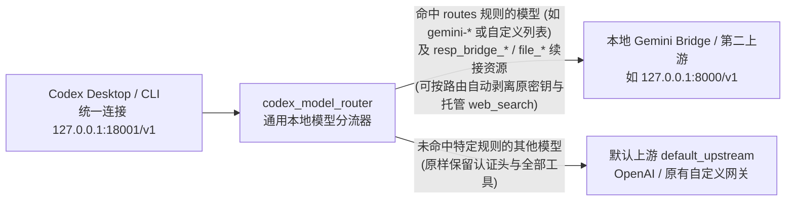

# Codex 通用多供应商模型分流指南（多上游同菜单共存）

在默认情况下，Codex Desktop / CLI 同一时间只能指向一个 `model_provider`（要么连接原 GPT 供应商，要么单独连接本地 `127.0.0.1:8000` 的 Gemini Bridge）。

本仓库内置的 **`codex_model_router`** 在本机回环地址（默认 `http://127.0.0.1:18001/v1`）启动一个零第三方依赖的通用本地分流服务，支持按**任意模型名称、通配符前缀（如 `gemini-*`）或多路由表**转发请求，让**原有供应商的全部模型**与**本地 Gemini Bridge（或其他兼容上游）的任意模型**同时出现在同一个 Codex 模型下拉菜单与子代理可选列表中。

---

## 1. 工作原理与安全边界



- **灵活模型匹配（支持任意模型名与通配符）**：不必固定使用某几个模型名称——在 `routes` 中既可填写通配符（例如 `["gemini-*"]`），也可填写你实际使用的具体模型 ID（例如 `["gemini-3.1-pro", "gemini-3.8-flash"]`），甚至配置多个不同的二级上游。
- **合并模型目录（`/v1/models`）**：将默认上游的模型列表快照与你指定的本地模型目录条目自动合并输出给 Codex。
- **严格密钥隔离（`strip_auth`）**：命中本地路由（含 `@会话ID` 亲和后缀）时，转发前会**自动剥离** `Authorization`、`Api-Key`、`X-Api-Key`、`Cookie`、`OpenAI-Organization` 等全部默认上游凭据，确保原供应商密钥绝不外泄。
- **工具与续接资源自动适配**：支持按路由开启 `strip_hosted_web_search`（过滤不兼容的托管 `web_search`，完整保留本地终端、补丁与 MCP 工具）及 `match_bridge_resources`（让不带 `model` 字段的 `resp_bridge_*` 续接和 `file_*` 附件自动回到本地 Bridge）。

---

## 2. 一键安装与自动同步（macOS / Windows / Linux）

确保本仓库虚拟环境已准备就绪后，在仓库根目录运行安装脚本：

### 第一步：预览将要写入的配置（Dry-Run，不改任何文件）

```bash
./.venv/bin/python codex_model_router/install_router.py \
  --default-upstream "https://你的原供应商地址/v1" \
  --route-models "gemini-*"
```

> - 如果你当前的 `~/.codex/config.toml` 还直接指着原供应商地址，可省略 `--default-upstream`，脚本会自动识别当前上游地址。
> - 如果你想在 Codex 下拉菜单中注册指定的模型名称（例如你账号可用的任意模型 ID），可附带 `--catalog-models "模型A,模型B"`；不传则默认合入仓库 `codex-models.json` 中的模板条目。

### 第二步：正式写入配置并配置开机自启

```bash
./.venv/bin/python codex_model_router/install_router.py \
  --default-upstream "https://你的原供应商地址/v1" \
  --route-models "gemini-*" \
  --install-autostart \
  --apply
```

执行 `--apply` 后，脚本会自动完成以下操作：

1. **自动安全备份**：将现有的 `~/.codex/config.toml`、`settings.json` 等文件备份到 `~/.codex/model-router/backups/router-setup-<时间戳>/`（权限锁定为仅当前用户可读）。
2. **部署分流程序与配置**：生成 `~/.codex/model-router/router.py`、`settings.json` 与合并后的 `models.json`。
3. **无损更新 `~/.codex/config.toml`**：仅将当前 `model_provider` 的 `base_url` 与 `model_catalog_url` 指向 `http://127.0.0.1:18001/v1` 并写入 `stream_idle_timeout_ms = 660000`，**原样保留**你的 API 密钥、MCP 服务、插件与个人偏好。
4. **配置开机自启**：
   - **macOS**：写入 `~/Library/LaunchAgents/local.codex-model-router.plist`，随后执行下方命令立即加载启动：
     ```bash
     launchctl unload ~/Library/LaunchAgents/local.codex-model-router.plist 2>/dev/null || true
     launchctl load ~/Library/LaunchAgents/local.codex-model-router.plist
     ```
   - **Windows 10 / 11**：在系统启动目录生成无黑框后台启动脚本 `CodexModelRouter.cmd`（也可随时手动运行 `python ~/.codex/model-router/router.py`）。

### 第三步：验证健康状态并重启 Codex

```bash
curl http://127.0.0.1:18001/health
# 预期返回: {"status": "ok"}
```

完全退出并重新打开 Codex Desktop，即可在模型选择菜单中同时看到原有供应商模型与新增的本地路由模型。

---

## 3. 手动配置模板参考（支持多上游扩展）

如果你希望纯手动维护 `~/.codex/model-router/settings.json`，可参考仓库内的脱敏模板 `codex_model_router/settings.example.json`：

```json
{
  "port": 18001,
  "default_upstream": "https://api.openai.com/v1",
  "routes": [
    {
      "name": "local-bridge",
      "upstream": "http://127.0.0.1:8000/v1",
      "models": [
        "gemini-*"
      ],
      "strip_auth": true,
      "strip_hosted_web_search": true,
      "match_bridge_resources": true,
      "timeout": 660
    }
  ]
}
```

> 兼容旧版简写：原有的 `{"original": "...", "gemini": "...", "port": 18001, "gemini_models": [...]}` 平铺格式同样完全兼容，无需手动迁移。
> **注意**：`~/.codex/model-router/settings.json` 与任何 `config-before-router-*.toml` 备份可能包含你的私人供应商地址或认证信息，已被本仓库 `.gitignore` 默认拦截，请勿强制提交到公开仓库。

---

## 4. 通用搭建与多代理协作指示（`AGENTS.md`）

为了让另一台设备上的 Codex 助手能自动帮你完成分流配置，或在日常多模型并行时有序协作，仓库提供了两份通用指示文件：

| 指示文件 | 放置位置 | 用途说明 |
| --- | --- | --- |
| `AGENTS.md` | 本仓库根目录 | 仓库通用维护规范：重启前先查 `/api/status` 在途请求、多会话局部补丁安全合入、敏感凭据防泄漏与测试要求 |
| `codex_model_router/AGENTS.global.example.md` | 发给 Codex 执行或按需复制到 `~/.codex/AGENTS.md` | 包含「AI 助手自动搭建模型分流的通用操作规范」与「多窗口并行 + 子代理（Subagent）跨模型总控协作规则」 |

此外，Gemini Bridge 本身还在以下模块中内置了针对 Codex 的自动协同支持：

- **`agent_policy.py` + `configure_codex_context.py`**：自动同步长上下文预算、稳定浓缩水位及桌面端编码工作流提示词。
- **多子代理并发席位分流（`bridge_hub.py` + `test_subagent_routing.py`）**：当同一个 Codex 主会话并行派生多个子代理（共享根 `prompt_cache_key` 但拥有独立 `thread_id`）时，Bridge 会自动将各子代理分配到独立空闲浏览器标签页（或自动后台新建标签页）并发执行，绝不互相排队或冲掉主会话上下文。

---

## 5. 日常维护与常见问题

1. **原供应商新增了新模型，下拉菜单里还没出现怎么办？**
   将原供应商最新的 `/v1/models` 返回结果保存为 JSON 文件，运行：
   ```bash
   ./.venv/bin/python codex_model_router/install_router.py --upstream-models /path/to/upstream-models.json --apply
   ```
   脚本会自动保留最新上游模型并重新合入本地模型条目（也可附加 `--catalog-models` 自定义要注册的模型名）。
2. **单独命令行临时指定配置仍可用吗？**
   完全兼容。分流器启用后，原有的独立 `--profile` 配置依然可以正常使用。
